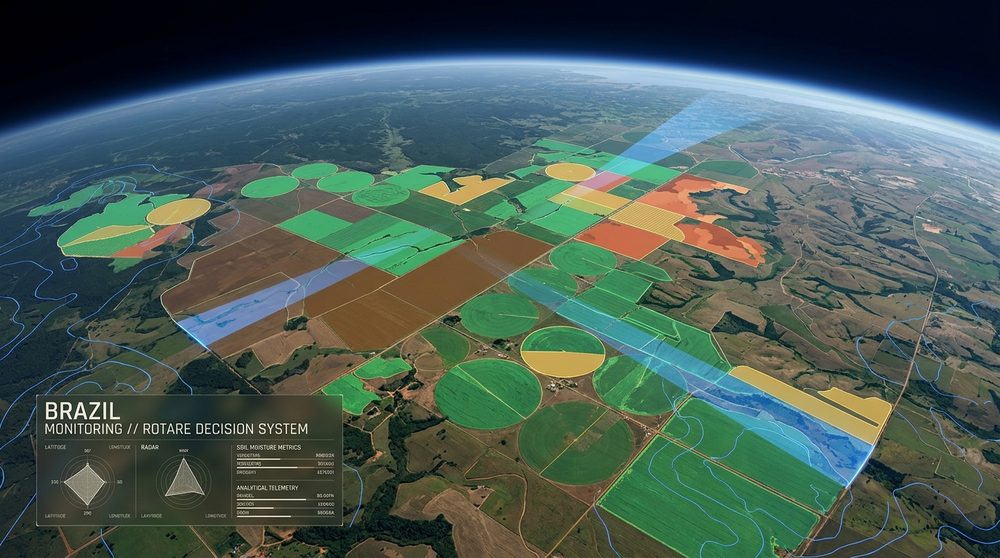

<div align="center">



# 🌱 Rotare

### Plan the next season with the next decade in mind.

[](#)
[](https://www.python.org/)
[](LICENSE)
[](https://www.spaceappschallenge.org/)
[](#-nasa--satellite-data)

**A decision-support tool that monitors Brazilian agricultural fields and helps farmers compare three-year crop rotations using NASA satellite data.**

*Built by **Datanauts Brasil** (São Paulo) for the NASA Space Apps Challenge 2026*  
*Challenge: Field Shift — Adapting Farms with NASA Data*

</div>

---

## 📋 Table of Contents

- [Overview](#-overview)
- [Visual Identity & Color System](#-visual-identity--color-system)
- [Key Features](#-key-features)
- [Platform Interface](#-platform-interface)
- [Architecture](#-architecture)
- [Project Status](#-project-status)
- [NASA & Satellite Data](#-nasa--satellite-data)
- [Early Findings](#-early-findings)
- [Getting Started](#-getting-started)
- [Data Output Reference](#-data-output-reference)
- [Known Limitations](#-known-limitations)
- [Use of Super Intelligence (SI)](#-use-of-super-intelligence-si)
- [Team](#-team)
- [License](#-license)

---

## 🔭 Overview

> *Tools tell you **when** to plant. Rotare compares **what sequence** to plant next.*

Rotare detects a field's crop history from NASA satellite vegetation data, simulates the climate risk of every planting date using NASA rainfall, weather and soil moisture data, and scores each rotation across four core semantic dimensions:

- 🌱 **Soil Health** (<code>#8B5E34 Terra</code> & <code>#3DBE7A Broto</code>) — organic carbon, physical texture, and erosion mitigation
- ☀️ **Climate Risk** (<code>#E76F51 Seca</code>) — drought hazard, critical water deficit frequency, and extreme heat days
- 💧 **Water Balance** (<code>#4C8DF6 Céu de Dados</code>) — NASA IMERG satellite rainfall, daily ET₀, and root-zone moisture
- 🌾 **Recommendations & Relative Return** (<code>#E9C46A Palhada</code>) — Pareto-optimal rotation ranking weighted by the farmer's priorities

The farmer sets the priorities. Rotare explains every result with the numbers behind it.

> [!IMPORTANT]
> **Decision support, not a decision maker.** Rotare compares scenarios in relative terms. It does not forecast yields and does not replace the farmer's agronomist.

---

## 🎨 Visual Identity & Color System

Designed in accordance with the project dossier, each color serves a direct semantic purpose across satellite layers, decision engine outputs, and UI visualizations:

| Color | Hex | Role | Meaning in Rotare |
|:---|:---:|:---|:---|
| **Noite Orbital** | `rgb(18, 20, 31)` / `#12141F` | Dark Background | Technological foundation, orbital perspective & deep space |
| **Palhada** | `rgb(233, 196, 106)` / `#E9C46A` | Highlights & CTAs | Optimal sequence recommendations & high-priority decision paths |
| **Broto** | `rgb(61, 190, 122)` / `#3DBE7A` | Positive Outcomes | Environmental health, crop vigor & positive soil indices |
| **Seca** | `rgb(231, 111, 81)` / `#E76F51` | Climate Risk | Severe drought alerts, extreme heat stress & climate vulnerability |
| **Céu de Dados** | `rgb(76, 141, 246)` / `#4C8DF6` | Satellite Streams | Satellite observations, NASA precipitation (IMERG) & moisture |
| **Terra** | `rgb(139, 94, 52)` / `#8B5E34` | Soil Indicators | Soil texture, clay content, organic matter & erosion metrics |
| **Papel** | `rgb(244, 241, 234)` / `#F4F1EA` | Text & UI Contrast | Primary typography, readability & high-contrast telemetry readout |

---

## ✨ Key Features

- 🛰️ **Satellite-based crop history detection** — 10-year NDVI/EVI series from MODIS and HLS to identify past crop cycles and bare-soil periods
- 🌧️ **Climate risk simulation** — daily water balance using NASA POWER weather and GPM IMERG satellite rainfall, bias-corrected per field
- 🌍 **ENSO-aware analysis** — classifies each crop year as El Niño, La Niña or neutral using NOAA's Oceanic Niño Index
- 🧪 **Soil characterization** — clay, organic carbon, pH and texture from ISRIC SoilGrids 2.0 (250 m), with erosion risk from SRTM elevation
- 📊 **Multi-criteria ranking** — Pareto-front scoring of three-year rotation sequences weighted by farmer priorities
- 🔄 **Fully reproducible** — one command collects all 13 open data sources; the app reads only local Parquet files

---

## 🖥️ Platform Interface

<div align="center">
  
</div>

*Multi-criteria analytics dashboard designed with the project dossier palette: 3-year crop sequence evaluation with Pareto ranking scores, historical satellite NDVI trend curves, GIS soil moisture and drought mapping, and 4-pillar radar diagnostic metrics.*

---

## 🏗 Architecture

```mermaid
flowchart LR
    subgraph SATS["🛰️ NASA & Open Satellite Data"]
        direction TB
        P["NASA POWER<br/>(Weather & Solar)"]
        G["GPM IMERG<br/>(Precipitation)"]
        M["MODIS & HLS<br/>(10-Yr NDVI / EVI)"]
        S["SMAP L4<br/>(Soil Moisture)"]
        SG["ISRIC SoilGrids<br/>(Texture & Carbon)"]
    end

    subgraph PIPELINE["⚡ Data Pipeline (coleta/)"]
        direction TB
        COL["coleta_rotare.py<br/>1-Command Ingestion"]
        PARQ[("Local Parquet & CSV<br/>data/<field>/")]
    end

    subgraph ENGINE["🧠 Decision Engine (motor/)"]
        direction TB
        CH["1. Crop History (NDVI Peaks)"]
        WB["2. Water Balance (ET₀ × Kc)"]
        SI["3. Relative Soil Conditioning"]
        RK["4. Pareto Multi-Criteria Ranking"]
    end

    subgraph UI["💻 Web Application (app/)"]
        APP["Streamlit Dashboard<br/>3-Year Rotation Matrix"]
    end

    SATS --> COL --> PARQ --> ENGINE --> UI
```



### Directory Structure

```
rotare/
├── coleta/          # Data collection pipeline (13 sources, one command)
│   ├── coleta_rotare.py    # Main collection script
│   ├── coletar.ps1         # PowerShell launcher (creates venv on first run)
│   ├── ecocrop_culturas.csv
│   └── requirements.txt
├── data/            # Collected field data (Parquet + CSV)
│   └── <field>/            # Field data for any coordinate (e.g., sample dataset)
├── motor/           # Decision engine (crop history, water balance, ranking)
├── app/             # Web interface (Streamlit)
├── REFERENCES.md    # Full citations and data licenses
└── LICENSE          # MIT
```

---

## 📌 Project Status

| Component | Directory | Status |
|:---|:---|:---:|
| Data collection pipeline (13 sources, one command) | [`coleta/`](coleta/) | ✅ Working |
| Field dataset collection (any Brazilian agricultural field) | [`data/`](data/) | ✅ Operational |
| Decision engine (crop history, water balance, soil index, ranking) | [`motor/`](motor/) | 🔧 In progress |
| Web application (Streamlit) | [`app/`](app/) | 🔧 In progress |

---

## 🛰 NASA & Satellite Data

### Primary NASA Data

| Product | Purpose | Access |
|:---|:---|:---|
| **NASA POWER** (daily, AG community) | Temperature, humidity and radiation for reference ET₀ (Hargreaves), frost and heat days | POWER API |
| **GPM IMERG Final V07** (monthly) | Satellite rainfall; corrects reanalysis bias and compares El Niño years | NASA GES DISC via `earthaccess` |
| **MODIS MOD13Q1 v061** (NDVI/EVI, 250 m, 16-day) | 10-year vegetation series to detect past crop cycles and bare-soil periods | AppEEARS |
| **SMAP L4 SPL4SMGP** (surface + root-zone soil moisture) | Validates simulated water balance | AppEEARS |
| **HLS v2.0** (Landsat 8/9 + Sentinel-2, 30 m) | Field-scale NDVI with Fmask cloud/shadow/water masking | AppEEARS |
| **SRTM 1 arc-second** (30 m) | Elevation and slope (Horn method) for erosion risk | OpenTopodata |

### Partner & Other Open Data

| Source | Purpose |
|:---|:---|
| ESA Sentinel-2 (inside HLS) | Field-scale vegetation |
| NOAA CPC Oceanic Niño Index (ONI) | El Niño / La Niña / neutral classification per crop year |
| ISRIC SoilGrids 2.0 (250 m) | Clay, sand, silt, organic carbon, pH, bulk density, CEC, nitrogen |
| MapBiomas Brazil (Collection 9, via Google Earth Engine) | Land use validation of detected crop history |
| MAPA ZARC risk tables (Brazil) | Official planting windows for validation |
| CHIRPS v2.0 daily rainfall (UCSB-CHG, via Google Earth Engine) | Daily observed rainfall since 1981 for the water balance; covers the 1997/98 El Niño, before IMERG |
| IBGE SIDRA, Municipal Agricultural Production (PAM, table 1612) | Official municipal yields since 1987, used to backtest the risk model |
| FAO ECOCROP | Crop climate and soil requirements |
| FAO Crop Calendar | Reference planting and harvest dates |
| IBGE locality API / OpenStreetMap Nominatim | Municipality lookup for selected coordinates |

> Full citations and licenses → [REFERENCES.md](REFERENCES.md)

---

## 📈 Early Findings

> **Brazilian agricultural case study: Crop years 2014–2024 (any field coordinates across Brazil can be simulated)**

Using IMERG satellite rainfall, the only two crop years with a strong water deficit coincided with the two strong El Niño events:

| Crop Year | ENSO Phase | Rainfall Anomaly |
|:---:|:---:|:---:|
| 2015/16 | Strong El Niño | **+369 mm** deficit |
| 2023/24 | Strong El Niño | **+456 mm** deficit |

La Niña years showed surpluses of up to **824 mm**. The POWER reanalysis underestimates rainfall in this region by up to half, which is why Rotare uses IMERG for rainfall totals.

Two more independent sources point the same way:

- **Official yields (IBGE PAM):** Sorriso's soybean yield hit its lowest value of 2010–2024 in the 2015/16 strong El Niño crop year (48 bags/ha), and fell from 62.5 to 58 bags/ha in 2023/24.
- **CHIRPS rainfall since 1981:** strong El Niño crop years are the driest group on average (1,881 mm vs 2,036 mm in La Niña years); 1997/98 was the driest of all (1,514 mm).

Satellite products disagree in some years (2023/24: IMERG 1,336 mm vs CHIRPS 2,003 mm), so Rotare shows rainfall as a range across sources, not a single value.

> [!NOTE]
> This is an observation for the analyzed field, not a generalized forecast. Any coordinate can be loaded and evaluated.

---

## 🚀 Getting Started

### Prerequisites

- **Python 3.11+**
- A free [NASA Earthdata](https://urs.earthdata.nasa.gov) account
- *(Optional)* A [Google Earth Engine](https://earthengine.google.com) project for MapBiomas

### Installation & Data Collection

#### Windows (PowerShell)

```powershell
cd coleta
copy .env.exemplo .env          # Fill in your Earthdata username, password and token
.\coletar.ps1                   # Runs default collection (creates virtualenv on first run)
.\coletar.ps1 -Lat -17.79 -Lon -50.92 -Nome rio_verde   # Collect for any field in Brazil
```

#### Linux / macOS

```bash
cd coleta
python -m venv .venv && source .venv/bin/activate && pip install -r requirements.txt
cp .env.exemplo .env            # Fill in credentials
python coleta_rotare.py --lat -17.79 --lon -50.92 --nome rio_verde --saida ../data
```

### How the Pipeline Works

- **Incremental** — skips sources already downloaded for the same point and period (use `--refazer` to force re-download)
- **Resilient** — resumes pending AppEEARS tasks; if one source fails, the others continue
- **Summary** — prints what completed and what is missing at the end
- **Offline demo** — the app reads only Parquet files in `data/`; no API is called at runtime

---

## 📂 Data Output Reference

Each field produces a directory under `data/<field>/` with the following structure:

| File | Description |
|:---|:---|
| `base_diaria.parquet` | Daily table: weather, Hargreaves ET₀, frost (Tmin ≤ 2 °C), heat (Tmax ≥ 35 °C), extreme rain (≥ 50 mm), NDVI, soil moisture, crop year, ENSO phase |
| `resumo_safras.parquet` | One row per crop year (Jul–Jun): rainfall (POWER, IMERG and CHIRPS), ET₀, water deficit, frost/heat days, ENSO class |
| `zarc.parquet` | Official planting risk (20/30/40 %) per crop, cycle, soil class and 10-day window |
| `aptidao_ecocrop.parquet` | Indicative climate suitability (0–1) for 18 crops per planting month |
| `manifesto.json` | Collection log with reference list for each source |
| `chirps.parquet`, `chirps_safras.parquet` | Daily CHIRPS rainfall since 1981 and its crop-year totals with ENSO class |
| `sidra_pam.parquet` | Official municipal area, production and yield per crop and year (IBGE PAM) |
| `csv/` | Full CSV copies of every table plus a data dictionary (via `python coleta/exportar_csv.py`) |

<details>
<summary><b>Individual source files</b></summary>

`power` · `imerg` · `ndvi_modis` · `ndvi_hls` · `smap_l4` · `solo` · `relevo` · `oni` · `mapbiomas` · `calendario_fao` — cleaned data, one file per source.

</details>

---

## ⚠️ Known Limitations

| Limitation | Detail |
|:---|:---|
| **NDVI ≠ soil health** | Used only to detect crop cycles and bare soil, not to measure soil quality |
| **SMAP L4 resolution** | 9 km model with data assimilation — validates regional behavior, not individual field values |
| **SoilGrids accuracy** | ML-based estimate with lower confidence in tropics; managed Cerrado soils have higher pH than predicted (lime application) — a lab report should replace it |
| **IMERG latency** | Final product has ~3.5 month delay; latest months may be unavailable |
| **El Niño mode** | Shows "if this year resembles past strong El Niño years" — never a forecast; only 2 strong events (2015/16, 2023/24) in the satellite record |

---

## 🤖 Use of Super Intelligence (SI)

*Declared in accordance with NASA Space Apps 2026 rules.*

- ✅ **The project idea, scope and all decisions are the team's own.**
- ✅ **AI coding assistants (Claude, Anthropic) helped write data collection and processing code.** Every AI-assisted file carries a disclosure comment at the top.
- ✅ **No data, numbers or results were generated by AI.** All values come from the NASA and partner open data listed above, processed by deterministic code in this repository.
- ✅ *If the explanation feature ships:* a language model translates farmer priorities into weights and explains computed results; a script verifies that every number exists in the engine output.
- ✅ AI-generated images, video or audio, if any, carry a visible watermark or notice.

> No NASA logo, flag or mission identifier is used or modified in this project.

---

## 👥 Team — Datanauts Brasil

<div align="center">
  
</div>

| Member | Role | Responsibilities | Core Domain |
|:---|:---|:---|:---|
| **Gabriel Henrique** | Project Owner & Solutions Architect | Strategic Direction, System Architecture & Science Integration | Strategy & Architecture |
| **Alan Nascimento** | Senior Data Specialist | Earth Observation Pipelines, NASA GES DISC & LP DAAC Ingestion | Data Engineering |
| **Marcelo** | Data Scientist & Agro-Climatologist | Climate Risk Simulation, Evapotranspiration & Soil Index Modeling | Climate & Soil Science |
| **Werlem** | Full-Stack Software Engineer | Decision Engine Algorithms, Pareto Optimization & Web Application | Software Engineering |

---

## 📄 License

**Code:** [MIT License](LICENSE)

**Data:** Files in `data/` retain the license of each original source (see [REFERENCES.md](REFERENCES.md)). NASA data is open access. SoilGrids, MapBiomas and ZARC are CC BY 4.0 / CC BY and require attribution.

---

<div align="center">

*These data were obtained from the NASA Langley Research Center (LaRC) POWER Project*  
*funded through the NASA Earth Science/Applied Science Program.*

**[Datanauts Brasil](https://github.com/datanauts-brasil) · NASA Space Apps Challenge 2026**

</div>
