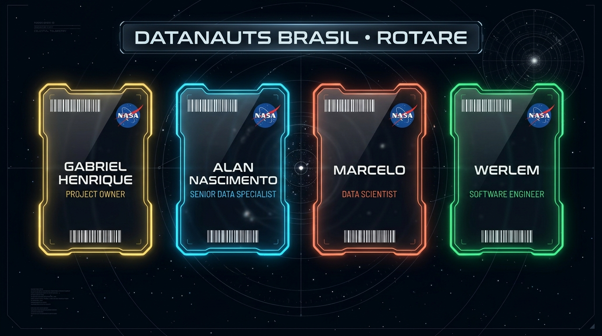

<div align="center">


# 🌱 Rotare

### Plan the next season with the next decade in mind.

[](#)
[](https://www.python.org/)
[](LICENSE)
[](https://www.spaceappschallenge.org/)
[](#-nasa--satellite-data)

**A decision-support tool that monitors Brazilian agricultural fields and helps farmers compare three-year crop rotations using NASA satellite data.**

*Built by **Datanauts Brasil** (São Paulo) for the NASA Space Apps Challenge 2026*  
*Challenge: Field Shift — Adapting Farms with NASA Data*

</div>

---

## 📋 Table of Contents

- [Overview](#-overview)
- [Visual Identity & Color System](#-visual-identity--color-system)
- [Key Features](#-key-features)
- [Platform Interface](#-platform-interface)
- [Architecture & Data Flow](#-architecture--data-flow)
- [Project Status](#-project-status)
- [NASA & Satellite Data](#-nasa--satellite-data)
- [Early Findings](#-early-findings)
- [Getting Started](#-getting-started)
- [Data Output & Validation Reference](#-data-output--validation-reference)
- [Known Limitations](#-known-limitations)
- [Declaration on the Use of Artificial Intelligence (SI)](#-declaration-on-the-use-of-artificial-intelligence-si)
- [Team — Datanauts Brasil](#-team--datanauts-brasil)
- [License](#-license)

---

## 🔭 Overview

> *Tools tell you **when** to plant. Rotare compares **what sequence** to plant next.*

Rotare detects a field's crop history from NASA satellite vegetation data, simulates the climate risk of every planting date using NASA rainfall, weather and soil moisture data, and scores each rotation across four core semantic dimensions:

- 🌱 **Soil Health** (<code>#8B5E34 Terra</code> & <code>#3DBE7A Broto</code>) — organic carbon, physical texture, and erosion mitigation
- ☀️ **Climate Risk** (<code>#E76F51 Seca</code>) — drought hazard, critical water deficit frequency, and extreme heat days
- 💧 **Water Balance** (<code>#4C8DF6 Céu de Dados</code>) — NASA IMERG satellite rainfall, daily ET₀, and root-zone moisture
- 🌾 **Recommendations & Relative Return** (<code>#E9C46A Palhada</code>) — Pareto-optimal rotation ranking weighted by the farmer's priorities

The farmer sets the priorities. Rotare explains every result with the numbers behind it.

> [!IMPORTANT]
> **Decision support, not a decision maker.** Rotare compares scenarios in relative terms. It does not forecast yields and does not replace the farmer's agronomist.

---

## 🎨 Visual Identity & Color System

Designed in accordance with the project dossier, each color serves a direct semantic purpose across satellite layers, decision engine outputs, and UI visualizations:

| Color | Hex | Role | Meaning in Rotare |
|:---|:---:|:---|:---|
| **Noite Orbital** | `rgb(18, 20, 31)` / `#12141F` | Dark Background | Technological foundation, orbital perspective & deep space |
| **Palhada** | `rgb(233, 196, 106)` / `#E9C46A` | Highlights & CTAs | Optimal sequence recommendations & high-priority decision paths |
| **Broto** | `rgb(61, 190, 122)` / `#3DBE7A` | Positive Outcomes | Environmental health, crop vigor & positive soil indices |
| **Seca** | `rgb(231, 111, 81)` / `#E76F51` | Climate Risk | Severe drought alerts, extreme heat stress & climate vulnerability |
| **Céu de Dados** | `rgb(76, 141, 246)` / `#4C8DF6` | Satellite Streams | Satellite observations, NASA precipitation (IMERG) & moisture |
| **Terra** | `rgb(139, 94, 52)` / `#8B5E34` | Soil Indicators | Soil texture, clay content, organic matter & erosion metrics |
| **Papel** | `rgb(244, 241, 234)` / `#F4F1EA` | Text & UI Contrast | Primary typography, readability & high-contrast telemetry readout |

---

## ✨ Key Features

- 🛰️ **Satellite-based crop history detection** — 10-year NDVI/EVI series from MODIS and HLS to identify past crop cycles and bare-soil periods
- 🌧️ **Climate risk simulation** — daily water balance using NASA POWER weather and GPM IMERG satellite rainfall, bias-corrected per field
- 🌍 **ENSO-aware analysis** — classifies each crop year as El Niño, La Niña or neutral using NOAA's Oceanic Niño Index
- 🧪 **Soil characterization** — clay, organic carbon, pH and texture from ISRIC SoilGrids 2.0 (250 m), with erosion risk from SRTM elevation
- 📊 **Multi-criteria ranking** — Pareto-front scoring of three-year rotation sequences weighted by farmer priorities
- 🔄 **Fully reproducible & dual-mode** — connects to live NASA APIs on demand, while providing bundled offline validation datasets in the repository

---

## 🖥️ Platform Interface

<div align="center">
  
</div>

*Multi-criteria analytics dashboard designed with the project dossier palette: 3-year crop sequence evaluation with Pareto ranking scores, historical satellite NDVI trend curves, GIS soil moisture and drought mapping, and 4-pillar radar diagnostic metrics.*

---

## 🏗 Architecture & Data Flow

```mermaid
flowchart LR
    subgraph SATS["🛰️ Live NASA & Open APIs"]
        direction TB
        P["NASA POWER API<br/>(Weather & Solar)"]
        G["GPM IMERG (GES DISC)<br/>(Precipitation)"]
        M["MODIS & HLS (AppEEARS)<br/>(10-Yr NDVI / EVI)"]
        S["SMAP L4 (NSIDC)<br/>(Soil Moisture)"]
        SG["ISRIC SoilGrids API<br/>(Texture & Carbon)"]
    end

    subgraph PIPELINE["⚡ Ingestion Pipeline (coleta/)"]
        direction TB
        COL["coleta_rotare.py<br/>Automated Ingestion"]
    end

    subgraph STORAGE["💾 Git-Bundled Datasets (data/)"]
        direction TB
        PARQ[("Local Storage<br/>Parquet & CSV<br/>★ Immediate Judge Validation")]
    end

    subgraph ENGINE["🧠 Decision Engine (motor/)"]
        direction TB
        CH["1. Crop History (NDVI Peaks)"]
        WB["2. Water Balance (ET₀ × Kc)"]
        SI["3. Relative Soil Conditioning"]
        RK["4. Pareto Multi-Criteria Ranking"]
    end

    subgraph UI["💻 Web Application (app/)"]
        APP["Streamlit Dashboard<br/>3-Year Rotation Matrix"]
    end

    SATS -->|Live Ingestion| COL
    COL -->|Saves to| PARQ
    PARQ -->|Zero-Setup Offline Read| ENGINE
    ENGINE --> UI
```



> [!TIP]
> **Live API vs. Offline Validation Datasets:**  
> All data used by Rotare is dynamically queryable via NASA and partner APIs for **any coordinate** in Brazil. However, to allow hackathon judges and evaluators to **immediately inspect, run, and validate** our methodology without requiring Earthdata credentials, GEE authorization, or waiting for satellite queues, full pre-collected datasets are already committed right here in [`data/`](data/) (in both Parquet and CSV formats).

### Directory Structure

```
rotare/
├── assets/img/      # Visual assets, platform mockups, and team badges
├── coleta/          # Data collection pipeline (13 open sources, single command)
│   ├── coleta_rotare.py    # Main API ingestion script
│   ├── coletar.ps1         # Windows PowerShell launcher (auto venv setup)
│   ├── ecocrop_culturas.csv
│   ├── exportar_csv.py     # Exports Parquet to CSV for easy inspection
│   └── requirements.txt
├── data/            # Pre-collected field datasets for immediate evaluation
│   └── sorriso/            # Validated benchmark dataset (Parquet + CSV + metadata)
├── motor/           # Decision engine (crop history, water balance, ranking)
├── app/             # Web interface (Streamlit dashboard)
├── REFERENCES.md    # Exhaustive citations, licenses, and challenge guidelines
└── LICENSE          # MIT
```

---

## 📌 Project Status

| Component | Directory | Status | Notes |
|:---|:---|:---:|:---|
| Data collection pipeline (13 sources) | [`coleta/`](coleta/) | ✅ Working | Automated API fetching, token management & resumption |
| Pre-collected validation datasets | [`data/`](data/) | ✅ Bundled | Ready for instant offline evaluation (Parquet + CSV) |
| Decision engine (crop history, water balance, soil index) | [`motor/`](motor/) | 🔧 In progress | Deterministic algorithms, Pareto frontier optimization |
| Web application | [`app/`](app/) | 🔧 In progress | Streamlit interactive rotation comparison dashboard |

---

## 🛰 NASA & Satellite Data

### Primary NASA Data

| Product | Purpose | Access Method |
|:---|:---|:---|
| **NASA POWER** (daily, AG community) | Temperature, humidity and radiation for reference ET₀ (Hargreaves), frost and heat days | POWER REST API |
| **GPM IMERG Final V07** (monthly) | Satellite rainfall; corrects reanalysis bias and compares El Niño years | NASA GES DISC via `earthaccess` |
| **MODIS MOD13Q1 v061** (NDVI/EVI, 250 m, 16-day) | 10-year vegetation series to detect past crop cycles and bare-soil periods | NASA LP DAAC via AppEEARS API |
| **SMAP L4 SPL4SMGP** (surface + root-zone soil moisture) | Validates simulated water balance | NASA NSIDC DAAC via AppEEARS API |
| **HLS v2.0** (Landsat 8/9 + Sentinel-2, 30 m) | Field-scale NDVI with Fmask cloud/shadow/water masking | NASA LP DAAC via AppEEARS API |
| **SRTM 1 arc-second** (30 m) | Elevation and slope (Horn method) for erosion risk | OpenTopodata API |

### Partner & Other Open Data

| Source | Purpose |
|:---|:---|
| ESA Sentinel-2 (inside HLS) | Field-scale vegetation monitoring |
| NOAA CPC Oceanic Niño Index (ONI) | El Niño / La Niña / neutral classification per crop year |
| ISRIC SoilGrids 2.0 (250 m) | Clay, sand, silt, organic carbon, pH, bulk density, CEC, nitrogen |
| MapBiomas Brazil (Collection 9) | Ground-truth land use validation of detected crop history (via GEE) |
| MAPA ZARC risk tables (Brazil) | Official planting windows for agro-climatic risk validation |
| CHIRPS v2.0 daily rainfall (UCSB-CHG) | Daily observed rainfall since 1981 for long-term historical water balance |
| IBGE SIDRA PAM (Table 1612) | Official municipal agricultural yields since 1987 to backtest the risk model |
| FAO ECOCROP & Crop Calendar | Crop climate/soil requirements and reference planting/harvest calendars |
| IBGE Locality API / OpenStreetMap Nominatim | Municipality and administrative boundary lookup |

> Complete scientific citations, licenses, and data dictionaries → [REFERENCES.md](REFERENCES.md)

---

## 📈 Early Findings

> **Brazilian agricultural case study: Crop years 2014–2024 (any field coordinates across Brazil can be simulated)**

Using IMERG satellite rainfall, the only two crop years with a strong water deficit coincided with the two strong El Niño events:

| Crop Year | ENSO Phase | Rainfall Anomaly | Impact on Agronomic Water Balance |
|:---:|:---:|:---:|:---|
| 2015/16 | Strong El Niño | **+369 mm** deficit | Critical deficit during reproductive stage |
| 2023/24 | Strong El Niño | **+456 mm** deficit | Severe planting delays and yield contraction |

La Niña years showed surpluses of up to **824 mm**. The POWER reanalysis underestimates rainfall in this region by up to half, which is why Rotare uses IMERG for rainfall totals.

Independent cross-validation confirms this behavior:

- **Official yields (IBGE PAM):** Municipal soybean yield hit its lowest level of the 2010–2024 period during the 2015/16 strong El Niño (48 bags/ha), and dropped from 62.5 to 58 bags/ha in 2023/24.
- **CHIRPS rainfall since 1981:** Strong El Niño crop years are systematically the driest group on average (1,881 mm vs. 2,036 mm in La Niña years); 1997/98 was the driest on record (1,514 mm).

Because satellite products may disagree in specific seasons (e.g., 2023/24: IMERG 1,336 mm vs. CHIRPS 2,003 mm), Rotare presents rainfall as a range across sources rather than a single point estimate.

> [!NOTE]
> This is an empirical observation for the analyzed field, not an ungrounded forecast. Any coordinate can be loaded and evaluated.

---

## 🚀 Getting Started

### Prerequisites

- **Python 3.11+**
- A free [NASA Earthdata](https://urs.earthdata.nasa.gov) account (required only when triggering live API downloads)
- *(Optional)* A [Google Earth Engine](https://earthengine.google.com) project for MapBiomas

> [!TIP]
> **Want to test immediately?** You don't need to configure Earthdata API keys to review Rotare! The bundled datasets in [`data/`](data/) allow you to inspect every table, run the export scripts, and test the decision engine right away.

### Option A: Immediate Offline Inspection (No Keys Required)

You can inspect the committed datasets directly:
```bash
# View CSV exports and schema dictionary
cd data/sorriso/csv
ls -la
```

Or regenerate full CSV exports from the Parquet files:
```bash
python coleta/exportar_csv.py
```

### Option B: Live API Data Collection (Any Coordinate)

#### Windows (PowerShell)

```powershell
cd coleta
copy .env.exemplo .env          # Fill in your Earthdata username, password and token
.\coletar.ps1                   # Runs default collection (creates virtualenv on first run)
.\coletar.ps1 -Lat -17.79 -Lon -50.92 -Nome rio_verde   # Collect for any field in Brazil
```

#### Linux / macOS

```bash
cd coleta
python -m venv .venv && source .venv/bin/activate && pip install -r requirements.txt
cp .env.exemplo .env            # Fill in credentials
python coleta_rotare.py --lat -17.79 --lon -50.92 --nome rio_verde --saida ../data
```

### Pipeline Architecture Highlights

- **Incremental caching** — skips sources already downloaded for the same point and time range (`--refazer` forces a fresh download)
- **Resilient task resumption** — automatically polls and resumes asynchronous AppEEARS tasks
- **Non-blocking fallback** — if an upstream API encounters downtime, the remaining sources continue and a detailed summary highlights what is missing
- **Zero API calls during demo** — the user-facing web app operates on local Parquet files for instant, offline performance

---

## 📂 Data Output & Validation Reference

Each field directory under `data/<field>/` contains standardized, ready-to-use artifacts:

| File | Description | Format |
|:---|:---|:---:|
| `base_diaria.parquet` | Daily series: weather, Hargreaves ET₀, frost (≤ 2 °C), heat (≥ 35 °C), extreme rain (≥ 50 mm), NDVI, soil moisture, crop year, ENSO phase | Parquet / CSV |
| `resumo_safras.parquet` | Annual crop-year summary (Jul–Jun): rainfall (POWER, IMERG, CHIRPS), ET₀, water deficit, extreme temperature days, ENSO classification | Parquet / CSV |
| `zarc.parquet` | Official Brazilian agro-climatic planting risk (20/30/40 %) per crop, cycle, soil class, and 10-day period | Parquet / CSV |
| `aptidao_ecocrop.parquet` | Indicative climate suitability index (0–1) across 18 crops per planting month | Parquet / CSV |
| `chirps.parquet` / `chirps_safras.parquet` | Daily CHIRPS rainfall since 1981 and crop-year cumulative series | Parquet / CSV |
| `sidra_pam.parquet` | Official municipal planted area, production, and yield per crop since 1987 (IBGE PAM) | Parquet / CSV |
| `manifesto.json` | Complete provenance log with exact API timestamps, bounding coordinates, and citation list | JSON |
| `csv/` | Full CSV copies of every single table with comprehensive metadata | Directory |

<details>
<summary><b>View individual source files in <code>data/</code></b></summary>

`power` · `imerg` · `ndvi_modis` · `ndvi_hls` · `smap_l4` · `solo` · `relevo` · `oni` · `mapbiomas` · `calendario_fao` — cleaned and normalized, one file per source.

</details>

---

## ⚠️ Known Limitations

| Dimension | Limitation | Rotare Engineering Mitigation |
|:---|:---|:---|
| **Vegetation Index** | NDVI measures canopy greenness, not direct chemical soil fertility | Used strictly to detect crop cycles, planting/harvest dates, and bare-soil exposure periods |
| **Spatial Resolution** | SMAP L4 operates on a 9 km grid with data assimilation | Used to validate regional moisture dynamics, not as a point-scale sensor |
| **Soil Estimates** | SoilGrids 2.0 is a global ML model with lower confidence in tropical soils | Acknowledged as baseline; in managed Brazilian soils, liming alters native pH (4.8 baseline) — farmers can supply lab soil reports |
| **Satellite Latency** | GPM IMERG Final has an official latency of ~3.5 months | Complemented with NASA POWER near-real-time daily observations for the latest dates |
| **ENSO Simulation** | El Niño evaluation is historical analog analysis, not a deterministic weather forecast | Evaluates "how past strong El Niño seasons impacted this specific field", clearly communicating risk distributions |

---

## 🤖 Declaration on the Use of Artificial Intelligence (SI)

*In strict compliance with the **NASA Space Apps Challenge 2026 Rules** and the **Use of Super Intelligence (SI) Policy**:*

### 1. 100% Human Idealization, Creativity & Scientific Conception
- **The project idea, concept, problem definition, and architectural design are entirely our own.**
- The team (**Datanauts Brasil**) conceived the premise of Rotare: shifting agricultural decision support from single-season planting dates (*when*) to multi-year strategic rotation sequences (*what sequence*).
- All domain research, selection of NASA and open datasets, mathematical formulations (soil conditioning equations, bucket water balance, Pareto ranking criteria), and agronomic interpretations were conducted directly by the team members.

### 2. AI as a Development & Coding Assistant Only
- Generative AI coding assistants (Claude by Anthropic) were used **strictly as engineering aids** to assist with boilerplate software development, speed up API response parsing, refactor repetitive pipeline scripts, and format documentation tables.
- Every source code file that received assistance carries an explicit disclosure comment at the top.

### 3. Absolute Data Integrity — Zero AI Hallucination
- **No data, numbers, calculations, or satellite values were generated, simulated, or hallucinated by AI.**
- Every single metric, rainfall total, NDVI curve, and soil property originates directly from the verified NASA and partner open databases documented in [REFERENCES.md](REFERENCES.md).
- All calculations are processed through the deterministic, fully audit-proof mathematical engine in this repository.

> No NASA logo, flag, or official mission identifier is altered or misused in this project.

---

## 👥 Team — Datanauts Brasil

**São Paulo, Brazil**

<div align="center">
  
</div>

| Member | Role | Responsibilities | Core Domain |
|:---|:---|:---|:---|
| **Gabriel Henrique** | Project Owner & Solutions Architect | Strategic Direction, System Architecture & Science Integration | Strategy & Architecture |
| **Alan Nascimento** | Senior Data Specialist | Earth Observation Pipelines, NASA GES DISC & LP DAAC Ingestion | Data Engineering |
| **Marcelo** | Data Scientist & Agro-Climatologist | Climate Risk Simulation, Evapotranspiration & Soil Index Modeling | Climate & Soil Science |
| **Werlem** | Full-Stack Software Engineer | Decision Engine Algorithms, Pareto Optimization & Web Application | Software Engineering |

---

## 📄 License

**Code:** [MIT License](LICENSE)

**Data:** Files in [`data/`](data/) retain the license and terms of each respective upstream provider (see [REFERENCES.md](REFERENCES.md)). NASA datasets are open access in the public domain. SoilGrids, MapBiomas, and ZARC are CC BY 4.0 / CC BY and require appropriate attribution.

---

<div align="center">

*These data were obtained from the NASA Langley Research Center (LaRC) POWER Project*  
*funded through the NASA Earth Science/Applied Science Program.*

**[Datanauts Brasil](https://github.com/datanauts-brasil) · NASA Space Apps Challenge 2026**  
*Field Shift: Adapting Farms with NASA Data*

</div>
