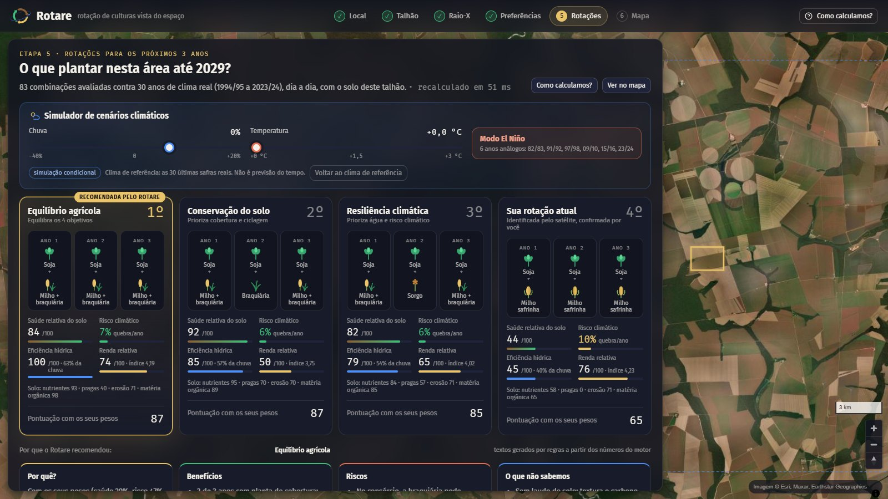
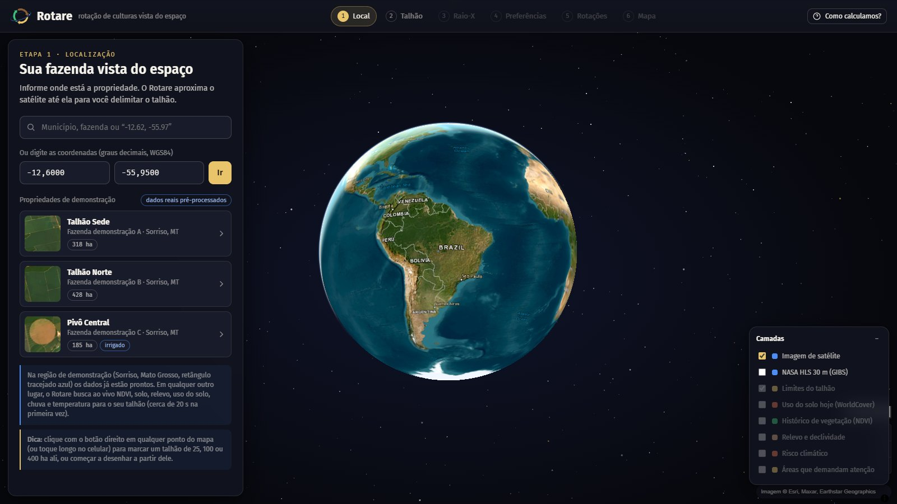
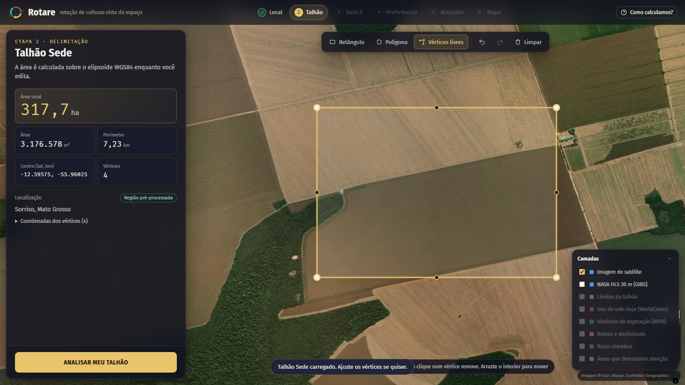
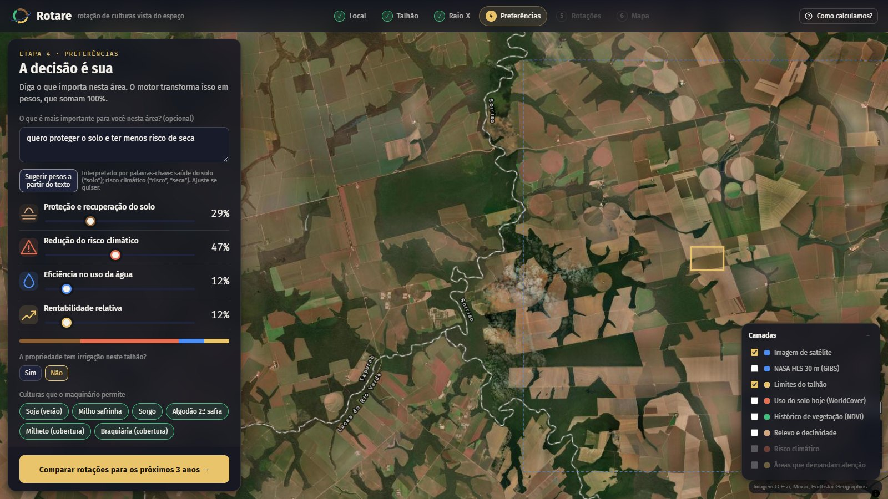
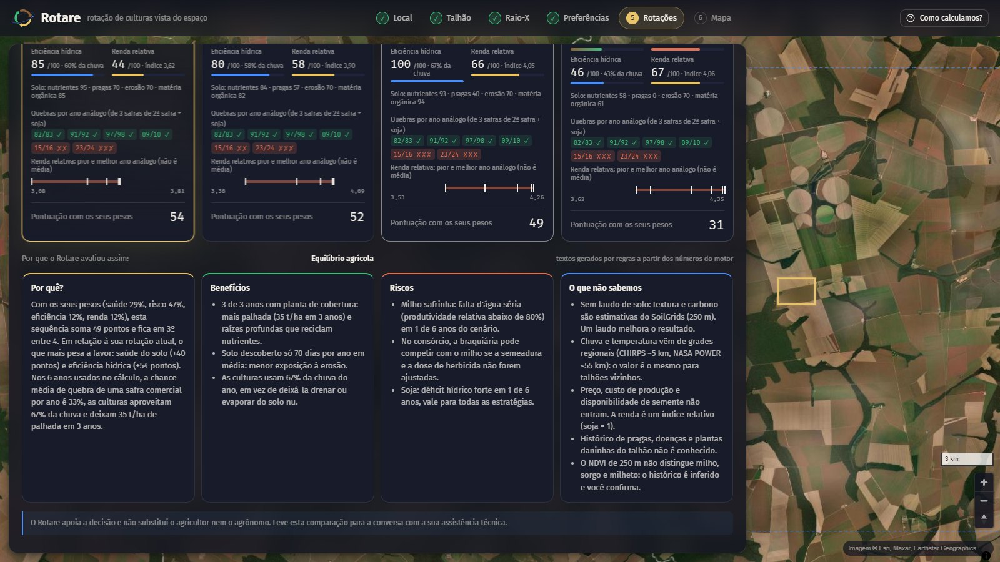
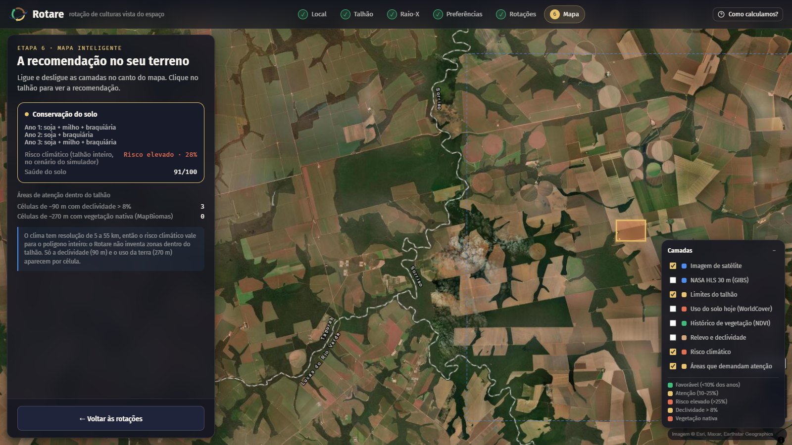
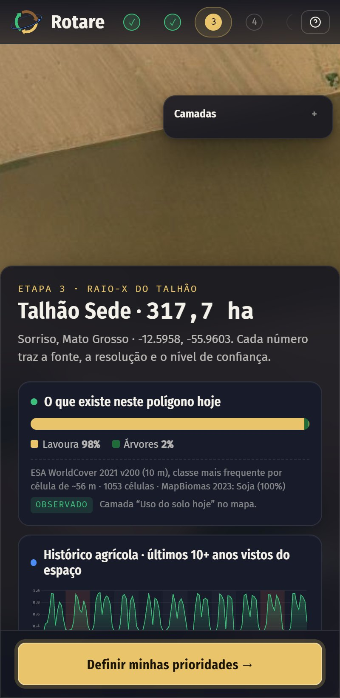
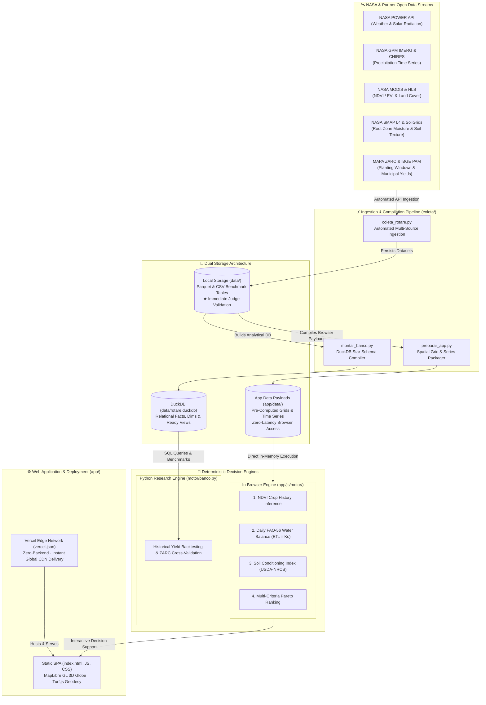

<div align="center">


# 🌱 Rotare

### Plan the next season with the next decade in mind.

[](#)
[](https://www.python.org/)
[](#-architecture--data-flow)
[](LICENSE)
[](https://www.spaceappschallenge.org/)
[](#-nasa--satellite-data)
[](#-getting-started)

**A decision-support tool that helps farmers compare three-year crop rotations using NASA satellite data, a deterministic FAO-based engine, and an interactive satellite map.**

*Built by **Datanauts Brasil** (São Paulo) for the NASA Space Apps Challenge 2026*  
*Challenge: Field Shift — Adapting Farms with NASA Data*

</div>

---

## 📋 Table of Contents

- [Overview](#-overview)
- [Visual Identity & Color System](#-visual-identity--color-system)
- [Key Features](#-key-features)
- [Platform Interface](#-platform-interface)
- [Architecture & Data Flow](#-architecture--data-flow)
- [Project Status](#-project-status)
- [NASA & Satellite Data](#-nasa--satellite-data)
- [Early Findings](#-early-findings)
- [Getting Started](#-getting-started)
- [Data Output & Validation Reference](#-data-output--validation-reference)
- [Known Limitations](#-known-limitations)
- [Declaration on the Use of Artificial Intelligence (SI)](#-declaration-on-the-use-of-artificial-intelligence-si)
- [Team — Datanauts Brasil](#-team--datanauts-brasil)
- [License](#-license)

---

## 🔭 Overview

> *Tools tell you **when** to plant. Rotare compares **what sequence** to plant next.*

Rotare detects a field's crop history from NASA satellite vegetation data, simulates the climate risk of every planting date using NASA rainfall, weather and soil moisture data, and scores each rotation across four core semantic dimensions:

- 🌱 **Soil Health** (<code>#8B5E34 Terra</code> & <code>#3DBE7A Broto</code>) — organic carbon, physical texture, and erosion mitigation
- ☀️ **Climate Risk** (<code>#E76F51 Seca</code>) — drought hazard, critical water deficit frequency, and extreme heat days
- 💧 **Water Balance** (<code>#4C8DF6 Céu de Dados</code>) — NASA IMERG satellite rainfall, daily ET₀, and root-zone moisture
- 🌾 **Recommendations & Relative Return** (<code>#E9C46A Palhada</code>) — Pareto-optimal rotation ranking weighted by the farmer's priorities

The farmer sets the priorities. Rotare explains every result with the numbers behind it.

> [!IMPORTANT]
> **Decision support, not a decision maker.** Rotare compares scenarios in relative terms. It does not forecast yields and does not replace the farmer's agronomist.

---

## 🎨 Visual Identity & Color System

Designed in accordance with the project dossier, each color serves a direct semantic purpose across satellite layers, decision engine outputs, and UI visualizations:

| Color | Hex | Role | Meaning in Rotare |
|:---|:---:|:---|:---|
| **Noite Orbital** | `rgb(18, 20, 31)` / `#12141F` | Dark Background | Technological foundation, orbital perspective & deep space |
| **Palhada** | `rgb(233, 196, 106)` / `#E9C46A` | Highlights & CTAs | Optimal sequence recommendations & high-priority decision paths |
| **Broto** | `rgb(61, 190, 122)` / `#3DBE7A` | Positive Outcomes | Environmental health, crop vigor & positive soil indices |
| **Seca** | `rgb(231, 111, 81)` / `#E76F51` | Climate Risk | Severe drought alerts, extreme heat stress & climate vulnerability |
| **Céu de Dados** | `rgb(76, 141, 246)` / `#4C8DF6` | Satellite Streams | Satellite observations, NASA precipitation (IMERG) & moisture |
| **Terra** | `rgb(139, 94, 52)` / `#8B5E34` | Soil Indicators | Soil texture, clay content, organic matter & erosion metrics |
| **Papel** | `rgb(244, 241, 234)` / `#F4F1EA` | Text & UI Contrast | Primary typography, readability & high-contrast telemetry readout |

---

## ✨ Key Features

- 🛰️ **Satellite-based crop history detection** — 10-year NDVI/EVI series from MODIS and HLS to identify past crop cycles and bare-soil periods, validated against MapBiomas ground-truth
- 🌧️ **Climate risk simulation** — FAO-56 daily water balance (Hargreaves ET₀ × crop Kc) with rainfall from CHIRPS, GPM IMERG and NASA POWER, shown as a range across sources
- 🌍 **ENSO-aware analysis** — classifies each crop year as El Niño, La Niña or neutral using NOAA's Oceanic Niño Index; "What-if El Niño" mode runs historical analogs
- 🧪 **Soil characterization** — clay, organic carbon, pH and texture from ISRIC SoilGrids 2.0 (250 m), plant-available water via Saxton & Rawls (2006), erosion risk from SRTM elevation
- 📊 **Multi-criteria ranking** — Pareto-front scoring of three-year rotation sequences across soil health, climate risk, water balance and relative return, weighted by farmer priorities
- 🗺️ **Interactive satellite map** — MapLibre globe with Esri imagery, NASA GIBS HLS layers, polygon editor (draw, edit, drag vertices), and analysis overlays (NDVI, slope, risk zones)
- 🔄 **Fully reproducible** — one command collects all 13 open sources for any coordinate; the app reads only the bundled data, so no API is called during the demo
- 🧪 **19 deterministic tests** — engine, geodesy, ranking, explainability and data integrity validated by automated tests (`node --test`)

---

## 🖥️ Platform Interface

**Journey:** Coordinate → Farm on satellite → Draw the field → X-Ray analysis → Set priorities → 3-year rotations → Climate simulator → Smart map.

<div align="center">
  
</div>

*Real screenshots of the working app (Talhão Sede, Sorriso, MT, real data). Nothing below is a mockup.*

| | |
| --- | --- |
|  |  |
| **1. Location.** Search a town, farm or `lat, lon`, or right-click anywhere on the map. | **2. Field.** Rectangle, polygon or free vertices; geodesic area (WGS84) updates live. |
|  |  |
| **3. X-ray.** What is inside the polygon today (ESA WorldCover 10 m), 10+ seasons of MODIS NDVI and the inferred crop history. | **4. Priorities.** Free text becomes weights that the farmer can adjust. |
|  |  |
| **5. El Niño mode.** The ranking is recomputed over the 6 strong El Niño years, showing each analog year (not an average). | **Explainability.** Why / Benefits / Risks / What we don't know, built only from engine numbers. |
|  |  |
| **6. Smart map.** Climate risk, slope and attention areas on the field. | **Any location, honest.** Live data for a polygon in downtown Campinas: 99% buildings, so the app refuses to recommend rotations. |

|  | |
| **Right-click menu.** Right-click (or long-press on mobile) anywhere: place name and coordinate, mark a 25 / 100 / 400 ha field there, start a rectangle or polygon anchored at that point, zoom in or copy the coordinate. | |

<p align="center"></p>

---

## 🏗 Architecture & Data Flow



### Architectural Highlights

1. **Ingestion Layer (`coleta/`)**: Automated scripts fetch data across 13 open sources with caching, retry logic, and token management. It handles NASA Earthdata APIs, Google Earth Engine, OpenTopodata, and Brazilian official registries (ZARC, IBGE PAM).
2. **Dual Storage Strategy (`data/` & `app/data/`)**:
   - **`data/`**: Standardized Parquet and CSV files for all benchmark fields, plus [`rotare.duckdb`](data/rotare.duckdb) providing relational star-schema tables and ready views for instant offline SQL exploration.
   - **`app/data/`**: Lightweight pre-compiled spatial grids and time-series arrays loaded directly by the browser for zero-latency execution.
3. **Deterministic Decision Engines**:
   - **Client-Side Engine (`app/js/motor/`)**: Executes 100% in the user's browser with no server roundtrips. Simulates daily soil water balance (FAO-56), relative yield penalties (FAO-33), soil health conditioning, and Pareto-optimal 3-year crop sequence rankings. Validated by 18 automated tests (`node --test`).
   - **Python Analytical Engine (`motor/banco.py`)**: Provides SQL helpers to query the DuckDB database, enabling validation against IBGE historical yields and official ZARC planting windows.
4. **Zero-Backend Global Web Deployment (`app/` + Vercel)**:
   - Built as a modern, static Single Page Application with MapLibre GL for 3D orbital-to-field mapping and Turf.js for geodesic spatial calculations.
   - Configured with root and subfolder [`vercel.json`](vercel.json) files for instant, zero-config deployment to the Vercel Edge Network.

> [!TIP]
> **Live API vs. Offline Validation Datasets:**  
> All data used by Rotare is dynamically queryable via NASA and partner APIs for **any coordinate** in Brazil. However, to allow hackathon judges and evaluators to **immediately inspect, run, and validate** our methodology without requiring Earthdata credentials, GEE authorization, or waiting for satellite queues, full pre-collected datasets are already committed right here in [`data/`](data/) (in both Parquet and CSV formats).

### Directory Structure

```
rotare/
├── assets/img/      # Team brand assets, Rotare logo and real app screenshots (app/)
├── coleta/          # Data collection pipeline (13 open sources, single command)
│   ├── coleta_rotare.py    # Main API ingestion script
│   ├── coletar.ps1         # Windows PowerShell launcher (auto venv setup)
│   ├── preparar_app.py     # Exports regional grids and field data for the app
│   ├── montar_banco.py     # Builds the DuckDB analytical database from the Parquet files
│   ├── BANCO.md            # Database model, tables and example queries
│   └── requirements.txt
├── data/            # Pre-collected field datasets for immediate evaluation
│   ├── rotare.duckdb       # Analytical database (all fields, rebuilt from the Parquet files)
│   ├── sorriso/            # Validated benchmark dataset (Parquet + CSV + metadata)
│   ├── pergamino/          # Pergamino, Argentina (global demo)
│   ├── iowa/               # Iowa, United States (global demo)
│   ├── punjab/             # Punjab, India (global demo)
│   └── eldoret/            # Eldoret, Kenya (global demo)
├── motor/           # Decision engine Python interface (banco.py)
├── app/             # Static web application (no backend, no API key, Vercel-ready)
│   ├── index.html          # Single-page entry point
│   ├── css/rotare.css      # Dossier palette UI
│   ├── js/motor/           # Deterministic engine: catalogo, balanco, rotacao, historico
│   ├── js/geo/             # Geoprocessing: polygon editor, zonal stats
│   ├── js/                 # MapLibre map, explainability, icons, main app
│   ├── data/               # Pre-processed JS data (clima, regiao, talhoes) + field images
│   ├── tests/              # 18 automated engine tests (node --test)
│   └── vercel.json         # Vercel sub-directory deployment config
├── vercel.json      # Root Vercel zero-config rewrites to /app
├── REFERENCES.md    # Exhaustive citations, licenses, and challenge guidelines
└── LICENSE          # MIT
```

---

## 📌 Project Status

| Component | Directory | Status | Notes |
|:---|:---|:---:|:---|
| Data collection pipeline (13 sources) | [`coleta/`](coleta/) | ✅ Working | Automated API fetching, token management & resumption |
| Pre-collected validation datasets | [`data/`](data/) | ✅ Bundled | 5 fields across 5 countries, ready for instant offline evaluation (Parquet + CSV) |
| Analytical database (DuckDB) | [`data/rotare.duckdb`](data/) | ✅ Built | Star-style model with dimensions, facts and ready-made views for the engine and app |
| Decision engine (FAO-56/FAO-33 water balance, ranking) | [`app/js/motor/`](app/js/motor/) | ✅ Working | Deterministic algorithms, Pareto frontier optimization, 18 automated tests |
| Web application (static SPA) | [`app/`](app/) | ✅ Working | MapLibre globe, polygon editor, crop history inference, climate simulator, rotation ranking |

---

## 🛰 NASA & Satellite Data

### Primary NASA Data

| Product | Purpose | Access Method |
|:---|:---|:---|
| **NASA POWER** (daily, AG community) | Temperature, humidity and radiation for reference ET₀ (Hargreaves), frost and heat days | POWER REST API |
| **GPM IMERG Final V07** (monthly) | Satellite rainfall; corrects reanalysis bias and compares El Niño years | NASA GES DISC via `earthaccess` |
| **MODIS MOD13Q1 v061** (NDVI/EVI, 250 m, 16-day) | Vegetation series since 2000 to detect past crop cycles and bare-soil periods | NASA LP DAAC, via Google Earth Engine (AppEEARS as fallback) |
| **MODIS MCD12Q1 v061** (IGBP land cover, 500 m, yearly) | Confirms the point is cropland in every country (MapBiomas adds detail in Brazil) | NASA LP DAAC, via Google Earth Engine |
| **SMAP L4 SPL4SMGP v008** (surface + root-zone soil moisture) | Validates simulated water balance (daily, since April 2015) | NASA NSIDC DAAC, via Google Earth Engine |
| **HLS v2.0** (Landsat 8/9 + Sentinel-2, 30 m) | Optional field-scale NDVI with Fmask cloud masking | NASA LP DAAC via AppEEARS API |
| **SRTM 1 arc-second** (30 m) | Elevation and slope (Horn method) for erosion risk | OpenTopodata API |

### Partner & Other Open Data

| Source | Purpose |
|:---|:---|
| ESA Sentinel-2 (inside HLS) | Field-scale vegetation monitoring |
| NOAA CPC Oceanic Niño Index (ONI) | El Niño / La Niña / neutral classification per crop year |
| ISRIC SoilGrids 2.0 (250 m) | Clay, sand, silt, organic carbon, pH, bulk density, CEC, nitrogen |
| MapBiomas Brazil (Collection 9) | Ground-truth land use validation of detected crop history (via GEE) |
| MAPA ZARC risk tables (Brazil) | Official planting windows for agro-climatic risk validation |
| CHIRPS v2.0 daily rainfall (UCSB-CHG) | Daily observed rainfall since 1981 for long-term historical water balance |
| IBGE SIDRA PAM (Table 1612) | Official municipal agricultural yields since 1987 to backtest the risk model |
| FAO ECOCROP & Crop Calendar | Crop climate/soil requirements and reference planting/harvest calendars |
| IBGE Locality API / OpenStreetMap Nominatim | Municipality and administrative boundary lookup |

> Complete scientific citations, licenses, and data dictionaries → [REFERENCES.md](REFERENCES.md)

---

## 📈 Early Findings

> **Brazilian agricultural case study: Crop years 2014–2024 (any field coordinates across Brazil can be simulated)**

Using IMERG satellite rainfall, the only two crop years with a strong water deficit coincided with the two strong El Niño events:

| Crop Year | ENSO Phase | Water deficit (ET₀ − IMERG rainfall) | Observed municipal outcome (IBGE PAM) |
|:---:|:---:|:---:|:---|
| 2015/16 | Strong El Niño | **+369 mm** | Lowest soybean yield of 2010–2024 (48 bags/ha) |
| 2023/24 | Strong El Niño | **+456 mm** | Soybean yield fell from 62.5 to 58 bags/ha |

La Niña years showed surpluses of up to **824 mm**. The POWER reanalysis underestimates rainfall in this region by up to half, which is why Rotare uses IMERG for rainfall totals.

Independent cross-validation confirms this behavior:

- **Official yields (IBGE PAM):** Municipal soybean yield hit its lowest level of the 2010–2024 period during the 2015/16 strong El Niño (48 bags/ha), and dropped from 62.5 to 58 bags/ha in 2023/24.
- **CHIRPS rainfall since 1981:** Strong El Niño crop years are systematically the driest group on average (1,881 mm vs. 2,036 mm in La Niña years); 1997/98 was the driest on record (1,514 mm).

Because satellite products may disagree in specific seasons (e.g., 2023/24: IMERG 1,336 mm vs. CHIRPS 2,003 mm), Rotare presents rainfall as a range across sources rather than a single point estimate.

> [!NOTE]
> This is an empirical observation for the analyzed field, not an ungrounded forecast. Any coordinate can be loaded and evaluated.

---

## 🚀 Getting Started

### Prerequisites

- **Python 3.11+**
- A free [NASA Earthdata](https://urs.earthdata.nasa.gov) account (required only when triggering live API downloads)
- *(Optional)* A [Google Earth Engine](https://earthengine.google.com) project for MapBiomas

> [!TIP]
> **Want to test immediately?** You don't need to configure Earthdata API keys to review Rotare! The bundled datasets in [`data/`](data/) allow you to inspect every table, run the export scripts, and test the decision engine right away.

### Option A: Immediate Offline Inspection (No Keys Required)

You can inspect the committed datasets directly:
```bash
# View CSV exports and schema dictionary
cd data/sorriso/csv
ls -la
```

Or regenerate full CSV exports from the Parquet files:
```bash
python coleta/exportar_csv.py
```

### Option B: Live API Data Collection (Any Coordinate)

#### Windows (PowerShell)

```powershell
cd coleta
copy .env.exemplo .env          # Fill in your Earthdata username, password and token
.\coletar.ps1                   # Runs default collection (creates virtualenv on first run)
.\coletar.ps1 -Lat -17.79 -Lon -50.92 -Nome rio_verde   # Collect for any field in Brazil
```

#### Linux / macOS

```bash
cd coleta
python -m venv .venv && source .venv/bin/activate && pip install -r requirements.txt
cp .env.exemplo .env            # Fill in credentials
python coleta_rotare.py --lat -17.79 --lon -50.92 --nome rio_verde --saida ../data
```

### Option C: Run Web Application Locally or Deploy to Vercel

The web application is a static Single Page Application (HTML5, CSS3, JavaScript, MapLibre GL, Turf.js) with zero backend dependencies:

```bash
# Run locally (any static HTTP server)
cd app
python -m http.server 8765
# Open in your browser: http://127.0.0.1:8765
```

**Deploy to Vercel (zero-config):**
- Import this GitHub repository directly into [Vercel](https://vercel.com).
- The included [`vercel.json`](vercel.json) automatically serves the application from `app/` with clean URLs and instant global CDN delivery.

### Option D: Run Engine Automated Tests

Validate the deterministic agronomic engine, FAO-56 water balance, and multi-criteria ranking:
```bash
node --test app/tests/motor.test.cjs
```

### Pipeline Architecture Highlights

- **Incremental caching** — skips sources already downloaded for the same point and time range (`--refazer` forces a fresh download)
- **Global by design** — any coordinate: NASA satellite data comes through Google Earth Engine in seconds; Brazil-only sources (ZARC, IBGE, MapBiomas) are added automatically when the point is in Brazil
- **Non-blocking fallback** — if an upstream API encounters downtime, the remaining sources continue and a detailed summary highlights what is missing
- **Zero API calls during demo** — the user-facing web app operates on local Parquet files for instant, offline performance

---

## 🗄️ Analytical Database (DuckDB)

All collected data is loaded into a single-file [DuckDB](https://duckdb.org/) database, [`data/rotare.duckdb`](data/), rebuilt from the Parquet files by `coleta/montar_banco.py` (idempotent, no server needed). The engine and the app query it with plain SQL.

| Layer | Tables | Grain |
|:---|:---|:---|
| Dimensions | `dim_talhao`, `dim_cultura`, `dim_fonte`, `dim_enso_safra` | One field / crop / data source / crop year |
| Facts | `fato_clima_diario` (1981–2025), `fato_chuva_imerg_mensal`, `fato_solo_camada`, `fato_solo_agua`, `fato_uso_terra`, `fato_producao_municipal`, `fato_zarc_risco`, `fato_zarc_janela`, `fato_aptidao_ecocrop` | Day, month, soil layer, year, 10-day period |
| References | `ref_ecocrop`, `ref_calendario_fao` | Crop parameters |
| Views | `vw_safra`, `vw_raio_x`, `vw_solo_0_30`, `vw_zarc_janela_atual` | Ready for the engine and the app screens |

```python
import duckdb
con = duckdb.connect("data/rotare.duckdb", read_only=True)
con.sql("SELECT ano_safra, chuva_chirps_mm, deficit_chirps_mm, enso_safra, soja_municipio_sc_ha FROM vw_safra").df()
```

Derived values are documented in [`coleta/BANCO.md`](coleta/BANCO.md): crop-year keys, 0–30 cm soil averages and plant-available water estimated with Saxton & Rawls (2006). Every table and view carries a description (`SELECT * FROM duckdb_tables()`).

---

## 📂 Data Output & Validation Reference

Each field directory under `data/<field>/` contains standardized, ready-to-use artifacts in both high-performance Parquet format and human-readable CSV format:

| File | Description | Format |
|:---|:---|:---:|
| `base_diaria.parquet` / `.csv` | Daily series: weather, Hargreaves ET₀, frost (≤ 2 °C), heat (≥ 35 °C), extreme rain (≥ 50 mm), CHIRPS rainfall, crop year, ENSO phase. NDVI (MODIS) and root-zone soil moisture (SMAP) columns | Parquet / CSV |
| `resumo_safras.parquet` / `.csv` | Annual crop-year summary (Jul–Jun): rainfall (POWER, IMERG, CHIRPS), ET₀, water deficit, extreme temperature days, ENSO classification | Parquet / CSV |
| `zarc.parquet` / `.csv` | Official Brazilian agro-climatic planting risk (20/30/40 %) per crop, cycle, soil class, and 10-day period | Parquet / CSV |
| `aptidao_ecocrop.parquet` / `.csv` | Indicative climate suitability index (0–1) across 18 crops per planting month | Parquet / CSV |
| `chirps.parquet` / `chirps_safras.parquet` | Daily CHIRPS rainfall since 1981 and crop-year cumulative series | Parquet / CSV |
| `sidra_pam.parquet` / `.csv` | Official municipal planted area, production, and yield per crop since 1987 (IBGE PAM) | Parquet / CSV |
| `manifesto.json` | Collection log: run time, point coordinates, status of each source and citation list | JSON |
| `csv/` | Directory containing full CSV copies of every table + dedicated README | Directory |

---

### 📖 CSV Data Dictionary (Dicionário de Dados)

All CSV files use UTF-8 encoding, comma (`,`) as column delimiter, and dot (`.`) as decimal separator. Direct access: [`data/sorriso/csv/`](data/sorriso/csv/).

#### 1. `base_diaria.csv` — Daily Agricultural & Environmental Series
*One record per day (4,383 days covering 2014–2025)*

| Column | Description | Unit / Source |
|:---|:---|:---:|
| `data` | Observation date (`YYYY-MM-DD`) | Calendar Date |
| `temp_media_c` | Mean air temperature at 2 m | °C (NASA POWER) |
| `temp_max_c` | Maximum daily air temperature at 2 m | °C (NASA POWER) |
| `temp_min_c` | Minimum daily air temperature at 2 m | °C (NASA POWER) |
| `chuva_power_mm` | Daily modeled rainfall (underestimates in tropical regions; use IMERG for totals) | mm/day (NASA POWER) |
| `chuva_chirps_mm` | Daily observed rainfall (satellite + stations, ~5 km) | mm/day (CHIRPS) |
| `umidade_rel_pct` | Relative air humidity at 2 m | % (NASA POWER) |
| `vento_2m_ms` | Wind speed at 2 m. **Unreliable at this point in the source data; not used** | m/s (NASA POWER) |
| `radiacao_mj_m2` | Surface all-sky incoming solar radiation | MJ/m²/day (NASA POWER) |
| `et0_hargreaves_mm` | Reference evapotranspiration calculated via Hargreaves equation (FAO-56) | mm/day (Derived) |
| `geada` | Frost risk occurrence indicator (`Tmin ≤ 2 °C`) | Boolean (`True`/`False`) |
| `calor_extremo` | Extreme heat stress indicator (`Tmax ≥ 35 °C`) | Boolean (`True`/`False`) |
| `chuva_extrema` | Extreme precipitation event indicator (`Rainfall ≥ 50 mm`) | Boolean (`True`/`False`) |
| `ano_safra` | Brazilian agricultural crop year (e.g., `2023` = July 2023 to June 2024) | Year Integer |
| `oni_max` / `oni_min` | Peak and trough Oceanic Niño Index anomaly between August and March | °C Anomaly (NOAA CPC) |
| `enso_safra` | ENSO classification: `el_nino_forte` (ONI ≥ 1.5), `el_nino_fraco_moderado`, `la_nina`, `neutro` | Category |

#### 2. `resumo_safras.csv` — Crop-Year Agronomic Balance
*One summary row per agricultural year (July to June)*

| Column | Description | Unit / Notes |
|:---|:---|:---:|
| `ano_safra` | Crop year (2023 = July 2023 to June 2024) | Integer |
| `chuva_power_mm` | Modeled cumulative rainfall for the crop year | mm (NASA POWER) |
| `chuva_imerg_mm` | Satellite-observed cumulative rainfall for the crop year (**preferred source**) | mm (GPM IMERG V07) |
| `et0_hargreaves_mm` | Total atmospheric water demand (cumulative reference evapotranspiration) | mm (FAO-56) |
| `deficit_hidrico_mm` | Water deficit from POWER (`ET₀ - Rainfall`); positive value = water deficit | mm |
| `deficit_hidrico_imerg_mm` | Water deficit using IMERG rainfall (empty when months are missing) | mm |
| `chuva_chirps_mm` | Cumulative crop-year rainfall from CHIRPS | mm (CHIRPS) |
| `deficit_hidrico_chirps_mm` | Water deficit using CHIRPS rainfall | mm |
| `geada` / `calor_extremo` / `chuva_extrema` | Total count of extreme weather days in that crop year | Days (Count) |
| `dias` / `safra_completa` | Number of recorded days and completeness flag (`True` for full comparisons) | Integer / Boolean |
| `meses_imerg` | Number of validated IMERG months available (12 = complete season) | Months (Count) |

#### 3. `zarc.csv` — Official MAPA Agricultural Climate Risk Zoning
*19,767 risk decêndio (10-day period) records from Brazil's Ministry of Agriculture*

| Column | Description | Values / Examples |
|:---|:---|:---|
| `safra` | Agricultural crop season | `2016/2017` to `2026/2027` |
| `cultura` | Target crop species | `Soja`, `Milho 2ª Safra`, `Algodão`, `Sorgo`, etc. |
| `ciclo` | Crop maturation group | `grupo_I` to `grupo_VI` (early to late maturing) |
| `solo` | Soil texture classification | `arenoso`, `textura_media`, `argiloso`, or AD1–AD6 |
| `manejo` | Farm management system | `Sequeiro` (rainfed) or `Irrigado` (irrigated) |
| `decendio` | 10-day planting window (1 = Jan 1–10 ... 36 = Dec 21–31) | 1 to 36 |
| `mes` / `dia_inicio` | Calendar month and starting day of the decêndio | Integer |
| `risco_pct` | Official climate risk tier | **20%**, **30%**, or **40%** (unlisted = unrecommended) |

#### 4. `chirps_safras.csv` — Long-Term Multi-Decade Rainfall Series
*46 crop years of historical rainfall since 1981*

| Column | Description |
|:---|:---|
| `chuva_chirps_mm` | Cumulative crop-year precipitation (July to June) from satellite + station CHIRPS |
| `dias` / `safra_completa` | Season day count and validation flag |
| `oni_max`, `oni_min`, `enso_safra` | Historical ENSO classification (includes 1997/98 strong El Niño, pre-dating IMERG) |

#### 5. `sidra_pam.csv` — Municipal Ground-Truth Production & Yields (IBGE PAM)
*Official historical municipality-scale agricultural yields (1987–2025) used for risk backtesting*

| Column | Description | Unit |
|:---|:---|:---:|
| `produto` | Agricultural commodity (`soja`, `milho`, `algodao_herbaceo`, `sorgo`, `feijao`, etc.) | Commodity |
| `ano_colheita` / `ano_safra` | Harvest year and corresponding crop year | Year |
| `area_plantada_ha` / `area_colhida_ha` | Municipal planted and harvested surface area | Hectares (ha) |
| `producao_t` | Total municipal harvest volume | Metric Tons (t) |
| `rendimento_kg_ha` / `rendimento_sc_ha` | Average municipal crop yield | kg/ha / 60 kg bags/ha |

<details>
<summary><b>6. Detailed Reference Tables by Individual Source</b></summary>

| CSV File | Source | Parameters & Metrics |
|:---|:---|:---|
| `power.csv` | NASA POWER API | Raw daily temperatures, rainfall, humidity, wind (unreliable here) and solar radiation |
| `imerg.csv` | NASA GES DISC | Monthly calibrated satellite rainfall (mm/month) from Jan 2014 to Sep 2025 |
| `chirps.csv` | UCSB Climate Hazards | High-resolution (~5 km) daily precipitation grid from 1981 to 2025 |
| `oni.csv` | NOAA Climate Prediction | 3-month running mean SST anomalies in the Niño 3.4 region since 1950 |
| `solo.csv` | ISRIC SoilGrids 2.0 | Clay, sand, silt (%), SOC (g/kg), pH, bulk density, CEC, and nitrogen across 5 depths (0–100 cm) |
| `relevo.csv` | NASA SRTM (OpenTopodata) | Altitude (m), slope percentage (%), and topographic erosion hazard classification |
| `mapbiomas.csv` | MapBiomas Collection 9 | Annual land-use and land-cover classification from 1985 to 2023 (Class 39 = Soybean) |
| `ecocrop_parametros.csv` | FAO ECOCROP | Thermal/rainfall thresholds (`TOPMN`, `TOPMX`, `TMIN`, `TMAX`, `ROPMN`, `ROPMX`), pH range, and cycle days for 18 crops |
| `aptidao_ecocrop.csv` | FAO ECOCROP Model | Indicative agro-climatic suitability index (0 to 1) per crop and planting month |
| `calendario_fao.csv` | FAO Crop Calendar | Reference agronomic sowing and harvesting calendar windows for Brazil |

</details>

---

## ⚠️ Known Limitations

| Dimension | Limitation | Rotare Engineering Mitigation |
|:---|:---|:---|
| **Vegetation Index** | NDVI measures canopy greenness, not direct chemical soil fertility | Used strictly to detect crop cycles, planting/harvest dates, and bare-soil exposure periods |
| **Spatial Resolution** | SMAP L4 operates on a 9 km grid with data assimilation | Used to validate regional moisture dynamics, not as a point-scale sensor |
| **Soil Estimates** | SoilGrids 2.0 is a global ML model with lower confidence in tropical soils | Acknowledged as baseline; in managed Brazilian soils, liming alters native pH (4.8 baseline) — farmers can supply lab soil reports |
| **Satellite Latency** | GPM IMERG Final has an official latency of ~3.5 months | Recent months rely on NASA POWER (a modeled reanalysis, not observations) and CHIRPS; incomplete IMERG seasons are flagged (`meses_imerg < 12`) |
| **ENSO Simulation** | El Niño evaluation is historical analog analysis, not a deterministic weather forecast | Evaluates "how past strong El Niño seasons impacted this specific field", clearly communicating risk distributions |

---

## 🤖 Declaration on the Use of Artificial Intelligence (SI)

*In strict compliance with the **NASA Space Apps Challenge 2026 Rules** and the **Use of Super Intelligence (SI) Policy**:*

### 1. Idea and decisions
- The team chose the Field Shift challenge and decided Rotare's concept, scope and priorities in its own ideation session.
- Before the event, AI tools were used as **research support**: analysing the challenge, past Space Apps projects, existing tools and candidate approaches. The team discussed these options and made the final decisions. That research document is not part of this repository.

<!-- TEAM: confirm that the two lines above describe how the idea was decided. If in doubt, check with the event mentors. -->

### 2. Code and documentation
- AI coding assistants (Claude by Anthropic) wrote most of the data collection pipeline in [`coleta/`](coleta/) and the first drafts of this README and [REFERENCES.md](REFERENCES.md), under the team's direction. The team reviewed, ran and edited them.
- AI also suggested some data sources (for example CHIRPS and IBGE SIDRA), which the team approved.
- Every AI-assisted code file carries a disclosure comment at the top.

### 3. Data integrity
- **No data values were generated by AI.** Every rainfall total, temperature, soil property, yield and risk value comes from the NASA and partner open data documented in [REFERENCES.md](REFERENCES.md), processed by the deterministic code in this repository.

### 4. Images
- The README images are real screenshots of the working app (`assets/img/app/`). The Rotare logo was vectorised with AI help from the team's own design.

> No NASA logo, flag, or official mission identifier is altered or misused in this project.

---

## 👥 Team — Datanauts Brasil

**São Paulo, Brazil**

| Member | Role | Core Domain |
|:---|:---|:---|
| [**Gabriel Henrique**](https://github.com/GabrielHenriqueCA) | Project Owner & Solutions Architect | Strategy & Architecture |
| **Alan Nascimento** | Senior Data Specialist | Data Engineering |
| **Marcelo** | Data Scientist & Agro-Climatologist | Data Engineering |
| **Werlem** | Full-Stack Software Engineer | Software Engineering |

---

## 📄 License

**Code:** [MIT License](LICENSE)

**Data:** Files in [`data/`](data/) retain the license and terms of each respective upstream provider (see [REFERENCES.md](REFERENCES.md)). NASA datasets are open access in the public domain. SoilGrids, MapBiomas, and ZARC are CC BY 4.0 / CC BY and require appropriate attribution.

---

<div align="center">


<br/>

*These data were obtained from the NASA Langley Research Center (LaRC) POWER Project*  
*funded through the NASA Earth Science/Applied Science Program.*

**Datanauts Brasil · NASA Space Apps Challenge 2026**  
*Field Shift: Adapting Farms with NASA Data*

</div>
