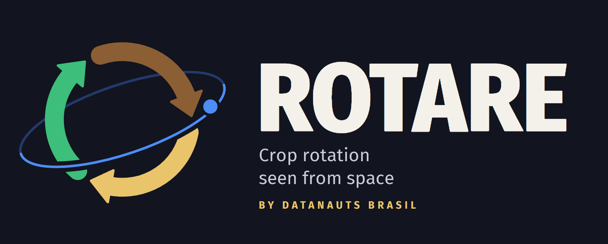
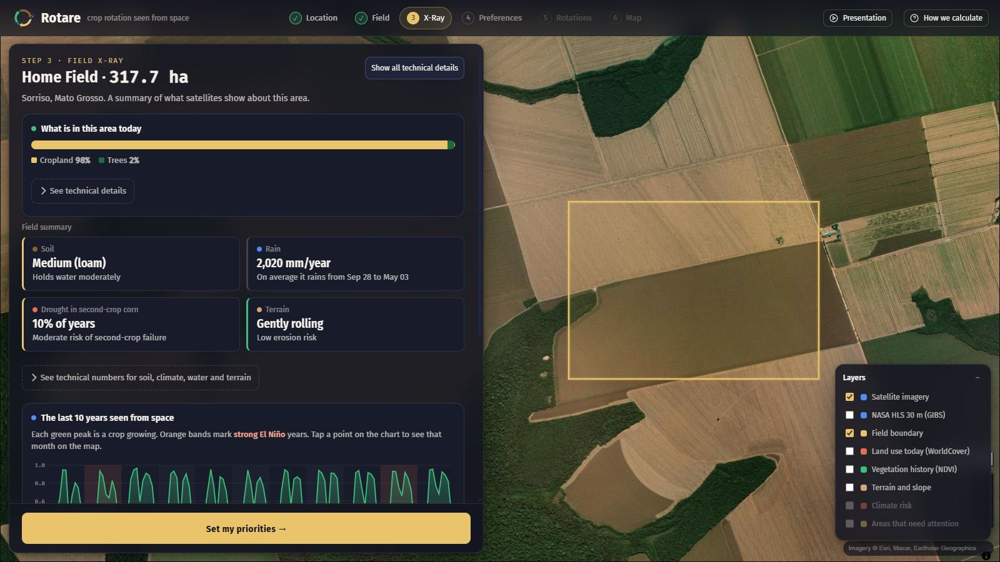
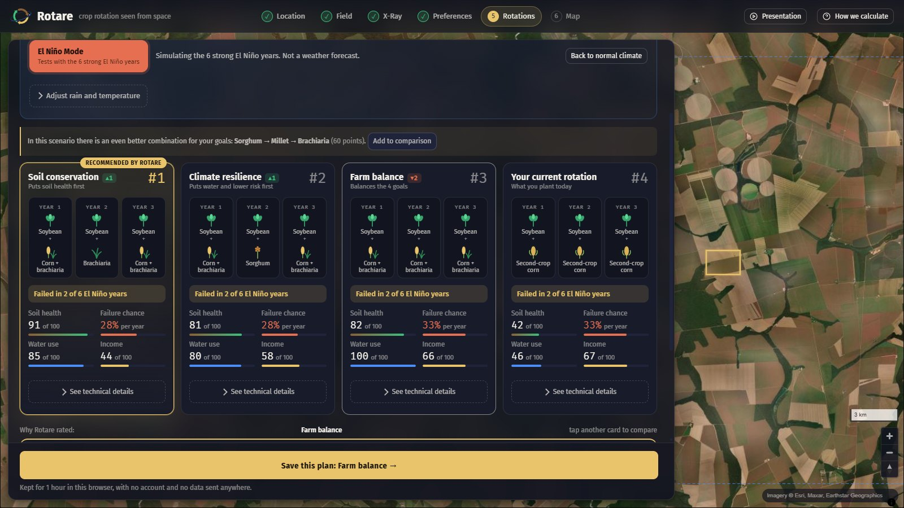
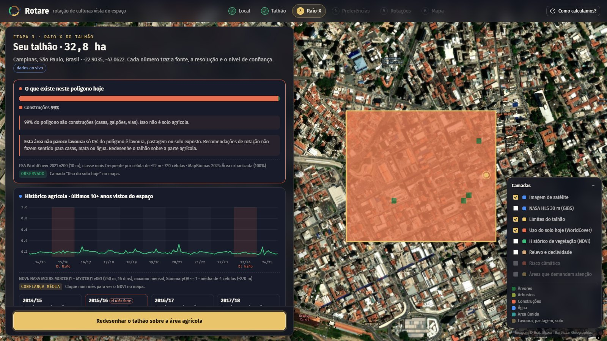
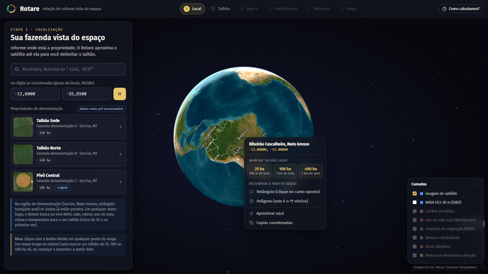
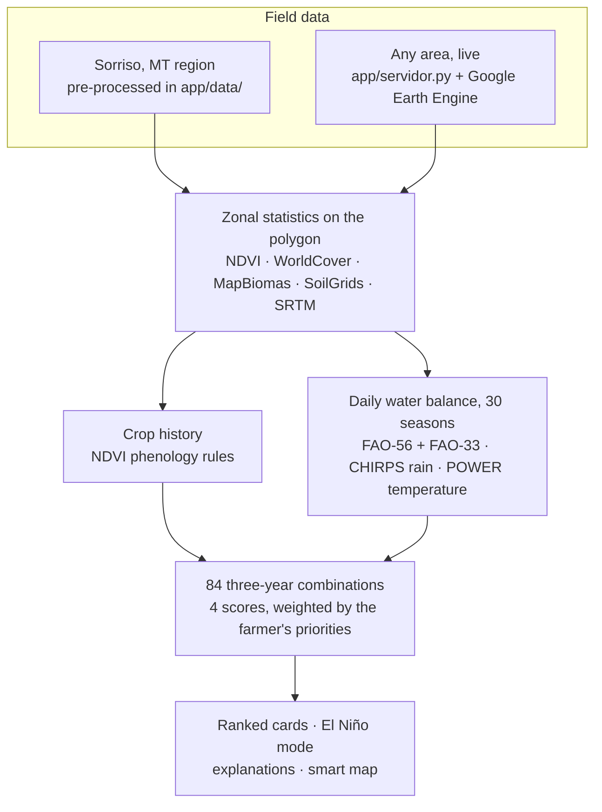

# 🌱 Rotare

### Plan the next season with the next decade in mind.

**Rotare helps farmers compare three-year crop rotations using NASA satellite data, a deterministic FAO-based engine and an interactive satellite map.**

*Built by **Datanauts Brasil** (São Paulo) for the NASA Space Apps Challenge 2026 · Challenge: **Field Shift — Adapting Farms with NASA Data***

---

## 📋 Contents

- [Overview](#-overview)
- [Plataform Interface](#-plataform-interface)
- [How It Works](#-how-it-works)
- [Data Sources](#-data-sources)
- [Early Findings](#-early-findings)
- [Known Limitations](#-known-limitations)
- [Use of Artificial Intelligence (SI)](#-use-of-artificial-intelligence-si)
- [Team](#-team--datanauts-brasil)
- [License](#-license)

---

## 🔭 Overview

> *Tools tell you **when** to plant. Rotare compares **what sequence** to plant next.*

Rotare detects a field's crop history from NASA satellite vegetation data, simulates every crop season of the last 30 years with satellite rainfall and NASA weather data, and scores each three-year rotation on four dimensions:

- 🌱 **Soil health**: crop residue, nutrient cycling, erosion and pest pressure
- ☀️ **Climate risk**: how often a crop would have failed from water deficit
- 💧 **Water use**: the share of the rainfall the crops actually use
- 🌾 **Relative return**: a relative margin index (soybean = 1), not a price

The farmer sets the priorities, and Rotare shows the numbers behind every result.

> [!IMPORTANT]
> **Decision support, not a decision maker.** Rotare compares scenarios in relative terms. It does not forecast yields and does not replace the farmer's agronomist.

### Key features

- 🛰️ **Crop history from orbit**: 10+ seasons of MODIS NDVI reveal past crop cycles and bare-soil periods, checked against MapBiomas
- 🌧️ **Climate risk simulation**: FAO-56 daily water balance and FAO-33 yield response over 30 seasons of CHIRPS rainfall
- 🌍 **El Niño mode**: the ranking can be recomputed over the past strong El Niño seasons only, one analog year at a time
- 🧪 **Soil and terrain**: SoilGrids texture and carbon, plant-available water via Saxton & Rawls (2006), slope from SRTM
- 🗺️ **Interactive satellite map**: MapLibre globe, polygon editor and analysis overlays (NDVI, slope, risk zones)
- 💬 **Explainable**: every card says why, the benefits, the risks and what the data cannot tell

---

## 🖥️ Plataform Interface

**Journey:** Coordinate → Farm on satellite → Draw the field → X-ray analysis → Set priorities → 3-year rotations → Climate simulator → Smart map.

*Real screenshots of the working app (Talhão Sede, Sorriso, MT, real data).*

| | |
| --- | --- |
|  |  |
| **1. Location.** Search a town, farm or `lat, lon`, or right-click anywhere on the map. | **2. Field.** Rectangle, polygon or free vertices; the geodesic area (WGS84) updates live. |
|  |  |
| **3. X-ray.** Current land cover inside the polygon (ESA WorldCover 10 m), 10+ seasons of MODIS NDVI and the inferred crop history. | **4. Priorities.** Free text becomes weights that the farmer can adjust. |
|  |  |
| **5. El Niño mode.** The ranking is recomputed over the 6 strong El Niño seasons, showing each analog year rather than an average. | **Explainability.** Why / Benefits / Risks / What we don't know, built only from engine numbers. |
|  |  |
| **6. Smart map.** Climate risk, slope and attention areas on the field. | **Honest about any location.** A polygon in downtown Campinas is 99% buildings, so the app refuses to recommend rotations. |

### 📱 Mobile View

The platform runs in the phone browser with the same journey. The panels open as a bottom sheet over the map.

| | |
| --- | --- |
|  |  |
| **Bottom sheet.** Every step of the journey fits the phone screen. | **Right-click menu.** Right-click (or long-press on mobile) to see the place and coordinate, mark a 25 / 100 / 400 ha field, start drawing from that point or copy the coordinate. |

---

## 🏗 How It Works

Rotare is a static website with two entry points: the pitch presentation (`/`, [`app/apresentacao.html`](app/apresentacao.html)) and the platform (`/explorar`, [`app/plataforma.html`](app/plataforma.html)). All analysis runs in the browser. There is no backend and no AI in the calculations.

1. **Field data.** The published site analyzes the Sorriso, MT region, whose grids and climate series are bundled in [`app/data/`](app/data/). With the optional local server ([`app/servidor.py`](app/servidor.py)), any drawn area is fetched live from Google Earth Engine and NASA POWER in seconds, using the same sources and methods.
2. **X-ray** ([`app/js/geo/zonal.js`](app/js/geo/zonal.js)). The grids are cut to the drawn polygon: current land cover (WorldCover), land use since 2014 (MapBiomas), soil texture and carbon (SoilGrids 0–30 cm) and slope (SRTM). Urban or non-agricultural areas are blocked.
3. **Crop history** ([`app/js/motor/historico.js`](app/js/motor/historico.js)). Simple phenology rules on the monthly NDVI curve infer each past season's crops. The result is always an inference that the farmer confirms or corrects.
4. **Water balance** ([`app/js/motor/balanco.js`](app/js/motor/balanco.js)). For each of the 30 most recent complete seasons, the engine simulates soybean at the start of the rains followed by each second-crop option. It uses a daily root-zone water balance (FAO-56) and the yield response to water deficit (FAO-33), with CHIRPS rainfall and Hargreaves ET₀ from NASA POWER temperatures. Crop parameters are in [`app/js/motor/catalogo.js`](app/js/motor/catalogo.js).
5. **Ranking** ([`app/js/motor/rotacao.js`](app/js/motor/rotacao.js)). There are seven second-crop options: corn, sorghum, cotton, millet, brachiaria, corn + brachiaria and fallow. They form 84 three-year combinations, and agronomic rules remove the invalid ones (for example, cotton two years in a row). Each combination gets four scores from 0 to 100: soil health (an index inspired by the USDA-NRCS Soil Conditioning Index), climate risk, water use and relative return. The cards show the farmer's current rotation, the best rotation for *Farm balance*, *Soil conservation* and *Climate resilience*, and one *Tailored to you* option that uses the farmer's own weights.
6. **Climate simulator.** Rainfall and temperature can be shifted, and El Niño mode replays only the 6 strong El Niño seasons (NOAA ONI). The cards keep their sequences and are re-ranked.
7. **Explanations** ([`app/js/explica.js`](app/js/explica.js)). Rules turn the engine numbers into text. No number is created at this step.

The collection pipeline ([`coleta/`](coleta/)) gathers every source for a coordinate into [`data/`](data/). That folder holds Parquet and CSV tables for five fields (Brazil, Argentina, USA, India and Kenya) and a DuckDB database. The data in [`data/`](data/) is used to validate the engine against IBGE yields and ZARC planting windows. 19 automated tests (`node --test app/tests/motor.test.cjs`) cover the engine, geodesy, ranking, explanations and data integrity.

---

## 🛰 Data Sources

### Used by the platform

| Source | What Rotare uses it for | Access |
|:---|:---|:---|
| **NASA MODIS MOD13Q1 / MYD13Q1 v061** (250 m) | Monthly NDVI since 2014 for the crop history and the NDVI layer | Google Earth Engine (AppEEARS in the pipeline) |
| **NASA POWER** (daily) | Temperatures for Hargreaves ET₀, frost and heat days | POWER REST API |
| **NASA GPM IMERG Final V07** (monthly, 0.1°) | Satellite rainfall shown alongside CHIRPS | Google Earth Engine / `earthaccess` |
| **NASA SMAP L4 v008** (9 km) | Root-zone soil moisture to check the simulated water balance | Google Earth Engine |
| **NASA HLS v2.0** (Landsat + Sentinel-2, 30 m) | Field images at the soybean and second-crop peaks | Google Earth Engine, NASA GIBS map layers |
| **SRTM 1 arc-second** (30 m) | Elevation and slope for erosion risk | Google Earth Engine / OpenTopodata |
| **CHIRPS v2.0** (daily, ~5 km) | Daily rainfall since 1981 that drives the water balance | Google Earth Engine |
| **NOAA CPC Oceanic Niño Index** | El Niño / La Niña / neutral class for each season | NOAA CPC |
| **ISRIC SoilGrids 2.0** (250 m) | Sand, clay and organic carbon (0–30 cm) | Google Earth Engine / SoilGrids API |
| **MapBiomas Brazil** (Collection 9) | Land use per year, to check the inferred crop history | Google Earth Engine |
| **ESA WorldCover v200** (10 m) | Current land cover inside the polygon (blocks urban areas) | Google Earth Engine |
| **Esri World Imagery / OpenStreetMap Nominatim** | Satellite basemap and place search | Public web services |

### Collected for validation

| Source | Purpose |
|:---|:---|
| **IBGE SIDRA PAM** (Table 1612) | Municipal yields since 1987, used to backtest climate risk |
| **MAPA ZARC** (Brazil) | Official planting windows and risk tiers |
| **NASA MODIS MCD12Q1 v061** (500 m) | Confirms the point is cropland outside Brazil |
| **FAO ECOCROP & Crop Calendar** | Crop climate requirements and reference calendars |

Full citations and licenses are in [REFERENCES.md](REFERENCES.md), and column-by-column data dictionaries are in [`data/sorriso/csv/LEIA-ME.md`](data/sorriso/csv/LEIA-ME.md).

---

## 📈 Early Findings

> **Case study: Sorriso, MT (Brazil).** Crop years run July–June. The water deficit is ET₀ (Hargreaves, NASA POWER) minus satellite rainfall (GPM IMERG); a positive value means a deficit.

In the 11 complete IMERG crop years (2014/15–2024/25), the two strong El Niño years had by far the largest water deficits. They were the only two years above +100 mm, and both match the weakest soybean results in the municipality:

| Crop year | ENSO phase | Water deficit (ET₀ − IMERG) | Municipal soybean yield (IBGE PAM) |
|:---:|:---:|:---:|:---|
| 2015/16 | Strong El Niño | **+369 mm** | 48.0 bags/ha, the lowest of 2010/11–2024/25 |
| 2023/24 | Strong El Niño | **+456 mm** | 58.0 bags/ha, down from 62.5 the year before |

- **La Niña years** were mostly wet, with surpluses of up to **824 mm** (2016/17). The exception is 2022/23, which had a small deficit (+80 mm).
- **CHIRPS since 1981** (44 complete crop years): strong El Niño years are the driest group on average, at **1,881 mm**. La Niña years average 2,036 mm, neutral years 2,000 mm and weak/moderate El Niño years 1,986 mm. 1997/98, a strong El Niño year, is the driest on record (1,514 mm).
- **Rainfall sources disagree.** NASA POWER (a reanalysis) records about half the satellite rainfall in several years; in 2018/19 it recorded 1,205 mm against 2,172 mm from IMERG and 2,636 mm from CHIRPS. Even the two satellite products differ (2023/24: IMERG 1,336 mm vs. CHIRPS 2,003 mm). This is why Rotare does not use POWER for rainfall and shows rainfall as a range across sources.

<b>All crop years (Sorriso, MT)</b>

| Crop year | ENSO phase | IMERG (mm) | CHIRPS (mm) | ET₀ (mm) | Deficit, IMERG (mm) | Soybean (bags/ha) |
|:---:|:---|---:|---:|---:|---:|---:|
| 2014/15 | Weak/moderate El Niño | 1,992 | 2,174 | 1,638 | −354 | 52.5 |
| 2015/16 | Strong El Niño | 1,445 | 1,943 | 1,814 | **+369** | **48.0** |
| 2016/17 | La Niña | 2,354 | 2,517 | 1,530 | −824 | 58.0 |
| 2017/18 | La Niña | 2,329 | 2,646 | 1,541 | −788 | 62.0 |
| 2018/19 | Weak/moderate El Niño | 2,172 | 2,636 | 1,607 | −565 | 59.0 |
| 2019/20 | Weak/moderate El Niño | 1,804 | 1,940 | 1,683 | −121 | 64.5 |
| 2020/21 | La Niña | 1,935 | 2,430 | 1,762 | −174 | 56.0 |
| 2021/22 | La Niña | 1,908 | 2,603 | 1,555 | −353 | 59.0 |
| 2022/23 | La Niña | 1,540 | 2,314 | 1,620 | +80 | 62.5 |
| 2023/24 | Strong El Niño | 1,336 | 2,003 | 1,792 | **+456** | **58.0** |
| 2024/25 | Neutral | 1,649 | 1,981 | 1,734 | +85 | 71.0 |

Computed from [`data/sorriso/csv/`](data/sorriso/csv/) (`imerg.csv`, `resumo_safras.csv`, `chirps_safras.csv`, `sidra_pam.csv`).

> [!NOTE]
> These are observations for one municipality, not a forecast. Yields also depend on factors other than rainfall, such as seeds, management and prices.

---

## ⚠️ Known Limitations

| Area | Limitation | How Rotare handles it |
|:---|:---|:---|
| **Vegetation index** | NDVI measures canopy greenness, not soil fertility | Used only to detect crop cycles, planting/harvest dates and bare soil |
| **Resolution** | SMAP L4 uses a 9 km grid and POWER ~55 km | Used for regional trends, not as point sensors; rainfall comes from CHIRPS (~5 km) |
| **Soil estimates** | SoilGrids is a global model with lower confidence in tropical soils | Treated as an estimate, and the app says so on every result; uploading a lab soil test is not supported yet |
| **Satellite latency** | IMERG Final arrives ~3.5 months late | Recent months use CHIRPS; incomplete IMERG seasons are flagged |
| **Crop parameters** | Kc, Ky and residue values come from literature (FAO-56, FAO-33, Embrapa) | Sources are cited in the code; the return index is relative, not a price |
| **El Niño** | Analog analysis of past seasons, not a weather forecast | Shows how past strong El Niño seasons affected this field, year by year |
| **Coverage** | The published site has data only for the Sorriso region | Other areas need the local server with Google Earth Engine |

---

## 🤖 Use of Artificial Intelligence (SI)

*In line with the **NASA Space Apps Challenge 2026 Rules** and the **Use of Super Intelligence (SI) Policy**:*

**1. Idea and decisions.** The team chose the Field Shift challenge and decided Rotare's concept, scope and priorities in its own ideation session. Before the event, AI tools were used as **research support** to analyse the challenge, past Space Apps projects, existing tools and candidate approaches. The team discussed these options and made the final decisions. That research document is not part of this repository.

<!-- TEAM: confirm that the paragraph above describes how the idea was decided. If in doubt, check with the event mentors. -->

**2. Code and documentation.** AI coding assistants (Claude by Anthropic) wrote much of the code under the team's direction: the data collection pipeline ([`coleta/`](coleta/)), the decision engine, map and interface ([`app/js/`](app/js/)), the local data server and the first drafts of this README and [REFERENCES.md](REFERENCES.md). The team defined the method, reviewed, ran and edited the code, and approved the data sources, some of which were suggested by AI (for example CHIRPS and IBGE SIDRA). Every AI-assisted code file carries a disclosure comment at the top.

**3. Data integrity.** **No data values were generated by AI.** Every rainfall total, temperature, soil property, yield and risk value comes from the open data listed in [REFERENCES.md](REFERENCES.md), processed by the deterministic code in this repository.

**4. No AI in the results.** The engine and the explanations are rules and formulas. No language model takes part in the ranking or writes the explanation text that the farmer sees.

**5. Images.** The README images are real screenshots of the working app. The Rotare logo was vectorised with AI help from the team's own design.

No NASA logo, flag or official mission identifier is altered or misused in this project.

---

## 👥 Team — Datanauts Brasil

**São Paulo, Brazil**

| Member | Role |
|:---|:---|
| [**Gabriel Henrique**](https://github.com/GabrielHenriqueCA) | Project Owner & Solutions Architect |
| **Alan Nascimento** | Senior Data Specialist |
| **Marcelo** | Data Analyst |
| **Werlem** | Full-Stack Software Engineer |

---

## 📄 License

**Code:** [MIT License](LICENSE).

**Data:** files in [`data/`](data/) keep the license of each upstream provider (see [REFERENCES.md](REFERENCES.md)). NASA datasets are open and in the public domain. SoilGrids, MapBiomas and ZARC are CC BY 4.0 / CC BY and require attribution.

---

*These data were obtained from the NASA Langley Research Center (LaRC) POWER Project*
*funded through the NASA Earth Science/Applied Science Program.*

**Datanauts Brasil · NASA Space Apps Challenge 2026**

