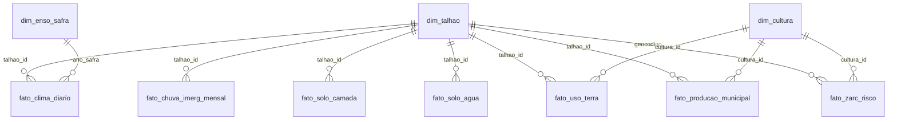

# Banco do Rotare (DuckDB)

Arquivo único: `data/rotare.duckdb`. Ele é montado a partir dos Parquet de `data/<talhao>/` por
`coleta/montar_banco.py`. O script recria o banco do zero a cada execução, então pode rodar quantas vezes
quiser. O `coletar.ps1` já roda a montagem no fim da coleta.

**Global:** o banco junta todos os talhões de `data/`, em qualquer país. Hoje são 5: Sorriso (BR), Pergamino (AR), Iowa (US), Punjab (IN) e Eldoret (KE). As fontes só do Brasil (ZARC, IBGE PAM, MapBiomas) aparecem apenas para pontos no Brasil.

```powershell
cd coleta
.\.venv\Scripts\python montar_banco.py
```

> Aviso de SI: o script e este documento foram escritos com ajuda de IA (Claude), sob direção do time.
> Nenhum valor é inventado. As colunas derivadas estão listadas no fim deste arquivo.

## Como usar no código

```python
from motor.banco import raio_x, safras, clima_diario, janelas_zarc, solo, culturas, consulta

raio_x("sorriso")                         # tela 2: clima médio, solo 0-30 cm, água disponível, relevo
safras("sorriso")                         # 1 linha por ano-safra completo desde 1981 (backtest)
clima_diario("sorriso", desde="2014-07-01")   # balanço hídrico diário (T8)
janelas_zarc("sorriso", "soja")           # janelas oficiais de plantio (validação)
consulta("SELECT * FROM fato_producao_municipal WHERE cultura_id = ?", ["soja"])
```

Também dá para abrir direto: `duckdb.connect("data/rotare.duckdb", read_only=True)`. No DBeaver ou no
DuckDB UI (`duckdb -ui`), abra o arquivo e veja as descrições com `SELECT * FROM duckdb_tables()`.

## Modelo



### Dimensões
| Tabela | Uma linha por | Destaques |
| --- | --- | --- |
| `dim_talhao` | talhão | lat, lon, país, local, mês de início do ano-safra, altitude, declividade, período coletado (município IBGE só no Brasil) |
| `dim_cultura` | cultura (20) | `cultura_id` único que liga ZARC, PAM, ECOCROP, MapBiomas e FAO. Só nomes e família botânica: o catálogo agronômico (T3) é do time |
| `dim_enso_safra` | talhão x ano-safra | ONI máximo e mínimo nos 6 meses centrais da safra daquele lugar, fase (`el_nino_forte` = ONI ≥ 1,5) |
| `dim_fonte` | fonte de dados | lida do `REFERENCES.md`: URL, licença e citação. Ajuda a montar o campo References |

### Fatos
| Tabela | Grão | Período | Observação |
| --- | --- | --- | --- |
| `fato_clima_diario` | talhão x dia | 1981 a 2025 | Chuva CHIRPS, clima NASA POWER e ET0 Hargreaves. A radiação do POWER só existe desde 1984 |
| `fato_chuva_imerg_mensal` | talhão x mês | 2014 a set/2025 | NASA GPM IMERG Final V07 |
| `fato_solo_camada` | talhão x propriedade x camada | 0 a 100 cm | SoilGrids, formato longo |
| `fato_solo_agua` | talhão x camada | 0 a 100 cm | Capacidade de campo, ponto de murcha e água disponível (mm) |
| `fato_uso_terra` | talhão x ano | 1985 a 2023 | MapBiomas Coleção 9 |
| `fato_producao_municipal` | município x produto x ano | 1987 a 2025 | IBGE PAM. É do **município**, não do talhão |
| `fato_zarc_risco` | município x safra x cultura x ciclo x solo x decêndio | 2016/17 a 2026/27 | Risco 20, 30 ou 40%. Decêndio ausente = plantio não indicado |
| `fato_zarc_janela` | mesma chave, por janela contínua | | Decêndios agrupados em início e fim (com a virada dez/jan) |
| `fato_aptidao_ecocrop` | talhão x cultura x mês de plantio | | Aptidão indicativa de 0 a 1 |
| `fato_ndvi_modis` | talhão x 16 dias | 2000 a 2025 | NASA MODIS MOD13Q1 via Earth Engine; nuvem e neve descartadas |
| `fato_smap` | talhão x dia | abr/2015 a 2025 | NASA SMAP L4 v008, umidade superficial e da zona de raízes (m³/m³) |
| `fato_uso_terra_modis` | talhão x ano | 2001 a 2024 | NASA MODIS MCD12Q1 (IGBP): 12 = lavoura. Funciona em qualquer país |

### Visões prontas
| Visão | Para quê |
| --- | --- |
| `vw_raio_x` | Tela 2 inteira em uma linha: chuva e ET0 médios, solo de 0 a 30 cm, água disponível até 60 e até 100 cm, relevo e uso recente |
| `vw_safra` | Backtest e validação: por ano-safra, chuva (CHIRPS, IMERG, POWER), ET0, déficit, dias extremos, ENSO, classe do MapBiomas e rendimento de soja e milho do município |
| `vw_solo_0_30` | Solo da camada arável |
| `vw_zarc_janela_atual` | Janelas de plantio de sequeiro da safra ZARC mais recente |

### Referências e controle
`ref_ecocrop` (parâmetros FAO por cultura), `ref_calendario_fao` (uma linha por sessão) e `meta_carga`
(status de cada fonte na última coleta).

## Colunas derivadas (o que não vem pronto da fonte)

| Coluna | Como é calculada |
| --- | --- |
| `ano_safra` | Ano agrícola do lugar, pelo `mes_inicio_safra` do talhão: 7 no hemisfério sul (2023 = jul/2023 a jun/2024), 1 no norte, 5 no Punjab (arroz + trigo). Na PAM, `ano_colheita - 1`. No ZARC, o primeiro ano da safra |
| `et0_hargreaves_mm` | Hargreaves & Samani (1985), com Ra da FAO-56, a partir das temperaturas do POWER |
| `geada`, `calor_extremo`, `chuva_extrema` | Tmin ≤ 2 °C, Tmax ≥ 35 °C e chuva CHIRPS ≥ 50 mm |
| `deficit_chirps_mm`, `deficit_imerg_mm` | ET0 da safra menos a chuva da safra (positivo = faltou água). Só em safras completas |
| `vw_solo_0_30.*` | Média das camadas 0-5, 5-15 e 15-30 cm, ponderada pela espessura |
| `umidade_cc_m3m3`, `umidade_pmp_m3m3`, `agua_disponivel_mm` | Saxton, K.E. & Rawls, W.J. (2006). Soil Sci. Soc. Am. J. 70:1569-1578, com areia, argila e matéria orgânica (carbono x 1,724) do SoilGrids. É uma **estimativa**: um laudo de solo do talhão substitui esse valor |
| `mapbiomas_ano_colheita` | Classe do MapBiomas no ano da colheita (`ano_safra + 1`) |
| `fato_zarc_risco.cultura_id`, `epoca`, `consorcio_braquiaria`, `finalidade` | Lidos do nome da cultura no ZARC (ex.: "Milho 2ª Safra consorciado com Braquiária") |

## Cuidados

- O balanço diário deve usar `chuva_chirps_mm`. O `chuva_power_mm` subestima a chuva na região.
- O `vento_2m_ms` do POWER está quebrado na origem neste ponto. Não usem.
- Os dados da PAM são do município inteiro. Servem para mostrar anos de quebra, não para medir o talhão.
- Para outro talhão: rodem o `coletar.ps1 -Lat ... -Lon ... -Nome ...`. O banco junta todos os talhões de `data/`.
